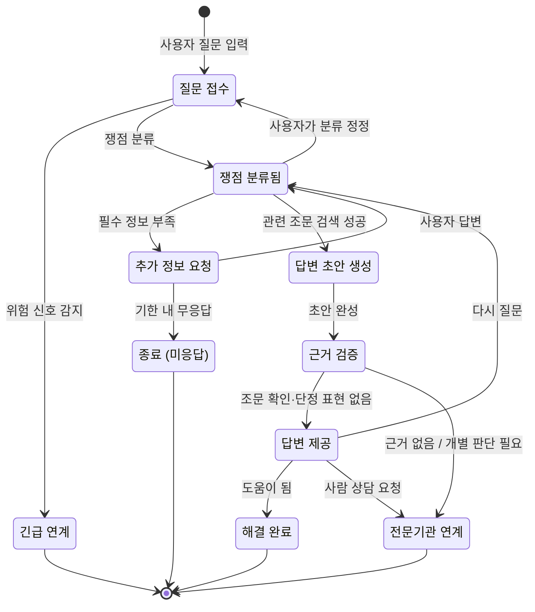

# 3. 규칙, 상태 전이, LLM이 들어갈 자리

> 목표: 클라이언트가 "이 경우엔요?"라고 물을 지점을 우리가 먼저 찾는다. 세부 주제의 필수 조건 두 가지(상태 전이, LLM)가 이 도메인의 어디에 들어갈 수 있는지 찾는다.

## 3-1. 규칙 (최소 5개)

> 규칙은 '항상 / 절대 / ~이면 ~한다' 형태로 씁니다. 예외는 '그런데 만약 ~라면?'으로 찾습니다.
> 예: "배송중이 된 주문은 셀러가 취소할 수 없다" → 만약 고객이 배송중에 취소를 요청하면?

| 번호 | 규칙 | 예외·경계 사례 (만약 ~라면?) | 어기면 생기는 문제 | 태그 | 출처 (카드 번호) |
| --- | --- | --- | --- | --- | --- |
| R1 | 챗봇은 **절대** 개별 사건의 결론(승소 여부, "이혼하면 반드시 추방된다" 등)을 단정하지 않고, 법 조문·제도의 일반 설명까지만 한다 (변호사가 아닌 자의 법률사무 금지, 변호사법 제109조) | 만약 사용자가 "그래서 저는 이혼해도 한국에 남을 수 있나요? 예/아니오로만 답해 주세요"라고 하면? → 판단 조건(귀책 사유, 자녀 양육 여부 등)을 설명하고 무료 법률상담 기관으로 연결 | 잘못된 단정으로 사용자가 체류·이혼·양육권에서 돌이킬 수 없는 결정을 함. 서비스가 법 위반 소지 | `[추정]` | 카드 필요 (변호사법 제109조) |
| R2 | 답변에는 **항상** 근거가 되는 법령명·조문 번호와 기준일(시행일)을 함께 보여 준다. 근거 조문을 찾지 못하면 답변을 내보내지 않는다 | 만약 법령이 아니라 행정 지침·하이코리아 안내문에만 있는 내용(예: 체류 연장 신청 가능 시점)이라면? → "법령이 아닌 행정 안내"라고 구분 표시 / 만약 질문 직후 법이 개정되었다면? | 출처 없는 답변을 사용자가 믿고 행동함. 틀린 답을 나중에 검증할 방법이 없음 | `[가정]` (서비스 규칙) | - |
| R3 | 국민의 배우자(F-6) 체류자격으로 사는 결혼이민자는 체류기간이 끝나기 **전에** 체류기간 연장 허가를 받아야 한다 (출입국관리법 제25조) | 만약 한국인 배우자가 연장 신청에 필요한 신원보증·동행을 거부하면? / 만약 이혼 소송 중이라면? | 기한을 넘기면 불법체류가 되어 범칙금·출국 조치 대상이 됨 | `[추정]` | 카드 필요 (출입국관리법 제25조) |
| R4 | 한국인 배우자의 가정폭력 등 **본인에게 책임이 없는 사유**로 혼인이 끝났으면, 결혼이민자는 혼인이 끝난 뒤에도 F-6 체류자격을 유지할 수 있다 (출입국관리법 시행령 별표 1의2, 결혼이민 F-6 다목) | 만약 폭력 증거(진단서·신고 기록)가 없다면? / 만약 사용자가 지금 위험한 상황이라면? → 법 설명보다 긴급 연결(112, 다누리콜센터 1577-1366)이 먼저 | "이혼하면 무조건 쫓겨난다"고 잘못 알고 폭력 가정에 계속 머무름 | `[추정]` | 카드 필요 (시행령 별표 1의2) |
| R5 | 한국에서 태어난 자녀는 출생 후 **1개월 이내**에 출생신고를 해야 한다 (가족관계의 등록 등에 관한 법률 제44조) | 만약 부모 둘 다 외국인이라면? → 가족관계등록 대상이 아니라 본국 대사관 신고 + 외국인등록 절차로 달라짐 / 만약 한국인 부가 신고를 하지 않으면? | 신고가 늦어 과태료가 나오고, 아동의 건강보험·보육료 지원이 늦어짐 | `[추정]` | 카드 필요 (가족관계등록법 제44조) |
| R6 | 사용자의 메시지에 폭력·위협·자해 같은 **위험 신호**가 있으면, 챗봇은 법률 설명보다 먼저 긴급 연락처를 안내한다 | 만약 위험 신호가 모국어 은어나 돌려 말한 표현이라 감지가 안 되면? / 만약 오탐이면? → 안내는 띄우되 대화는 계속 | 위급 상황에서 법 설명만 길게 해서 도움을 놓침 | `[가정]` (서비스 규칙) | - |

## 3-2. 핵심 대상과 상태 전이

> **필수 조건입니다.** 세부 주제에는 상태가 바뀌는 핵심 대상이 반드시 있어야 합니다. 핵심 대상 후보를 찾아 상태를 적습니다.
>
> 기준:
> - 상태가 **4개 이상**이고, 처음 상태에서 끝 상태까지 순서가 있습니다.
> - 정상 경로 말고 **취소·반려·되돌림·실패 경로가 1개 이상** 있습니다.
> - 전이마다 **누가 바꾸는지, 어떤 조건에서 바꾸는지** 적을 수 있습니다.
>
> 도메인별 예시 (그대로 쓰지 말고 조사한 내용으로 바꿉니다):
>
> | 도메인 | 핵심 대상 | 상태 흐름 예시 |
> | --- | --- | --- |
> | 오픈마켓 셀러 운영 백오피스 | 주문 | 결제완료 → 상품준비중 → 배송지시 → 배송중 → 배송완료 (취소요청 → 취소완료, 반품요청 → 반품완료) |
> | 러닝 자세·훈련 코칭 | 주간 훈련 계획 | 계획됨 → 진행중 → 기록 제출 → 피드백 완료 (기록 부족 → 재측정 요청) |
> | 다문화 가정 행정 절차 안내 | 절차 진행 건 | 준비중 → 서류 확인 → 제출 완료 → 처리 완료 (서류 부족 → 보완 요청 → 서류 확인) |

**핵심 대상 후보**: 법률 질문 상담 건 (사용자가 한 가지 법률 문제로 시작한 질문 1건)

| 지금 상태 | 다음 상태 | 누가 바꾸나 | 조건 | 되돌릴 수 있나 | 태그 |
| --- | --- | --- | --- | --- | --- |
| (시작) | 질문 접수 | 사용자 | 사용자가 모국어로 질문을 입력함 | - | `[가정]` |
| 질문 접수 | 긴급 연계 | 시스템 (규칙) | 위험 신호 키워드·분류가 걸림 (R6) | 아니오 (끝 상태). 사용자가 원하면 새 상담 건으로 다시 시작 | `[가정]` |
| 질문 접수 | 쟁점 분류됨 | 시스템 (LLM 분류 → 규칙으로 확정) | 질문이 정해진 분야(체류·혼인/이혼·자녀·국적·노동·복지) 중 하나로 분류됨 | 예 (사용자가 "그게 아니에요"를 누르면 질문 접수로) | `[가정]` |
| 쟁점 분류됨 | 추가 정보 요청 | 시스템 (규칙) | 답에 꼭 필요한 정보(체류자격, 혼인 상태, 자녀 유무 등)가 빠짐 | 예 | `[가정]` |
| 추가 정보 요청 | 쟁점 분류됨 | 사용자 | 사용자가 빠진 정보에 답함 | 예 | `[가정]` |
| 추가 정보 요청 | 종료 (미응답) | 시스템 (시간) | 일정 기간 사용자가 답하지 않음 | 예 (다시 답하면 이어서 진행) | `[가정]` |
| 쟁점 분류됨 | 답변 초안 생성 | 시스템 (LLM) | 분류된 쟁점에 맞는 법령 조문을 검색해서 찾음 | - | `[가정]` |
| 답변 초안 생성 | 근거 검증 | 시스템 (규칙) | 초안이 만들어짐 | - | `[가정]` |
| 근거 검증 | 답변 제공 | 시스템 (규칙) | 초안에 인용된 조문이 실제 법령 데이터에 있고, 단정 표현이 없음 (R1, R2) | - | `[가정]` |
| 근거 검증 | 전문기관 연계 | 시스템 (규칙) | 근거 조문을 찾지 못하거나, 개별 사건 판단이 필요한 질문임 (R1) | 아니오 (끝 상태) | `[가정]` |
| 답변 제공 | 해결 완료 | 사용자 | "도움이 되었어요"를 누름 | 예 (같은 건으로 다시 질문하면 쟁점 분류됨으로) | `[가정]` |
| 답변 제공 | 쟁점 분류됨 | 사용자 | "이해가 안 돼요 / 제 상황과 달라요"로 다시 질문 | 예 | `[가정]` |
| 답변 제공 | 전문기관 연계 | 사용자 | "사람과 상담하고 싶어요"를 누름 | 아니오 (끝 상태) | `[가정]` |

> 표를 다 채우면 아래처럼 그림으로도 그립니다. GitHub는 `mermaid` 코드 블록을 그림으로 보여 줍니다. 예시의 상태 이름과 화살표를 우리 내용으로 바꿉니다. 미리 보기는 GitHub의 파일 화면이나 편집 화면의 **Preview** 탭에서 확인합니다.

## 3-3. 시간에 따라 달라지는 규칙

> 기한, 마감, 주말·공휴일, 유효기간처럼 시간이 끼는 규칙을 1개 이상 적습니다. 3-2의 상태 전이와 이어지면 더 좋습니다.
> 예: 결제 후 ○영업일 안에 배송지시가 없으면 지연으로 표시한다 / 체류 기간 만료 ○일 전부터 연장 신청을 할 수 있다

| 규칙 | 기준 시간 | 주말·공휴일이면? | 태그 | 출처 (카드 번호) |
| --- | --- | --- | --- | --- |
| 90일을 넘게 머무를 외국인은 입국한 날부터 90일 이내에 외국인등록을 해야 한다 (출입국관리법 제31조) | 입국일 | 기간의 말일이 토요일·공휴일이면 그다음 날 끝난다 (민법 제161조) | `[추정]` | 카드 필요 |
| 체류기간 연장은 체류기간이 끝나기 전에 신청해야 하고, 하이코리아 안내상 만료 4개월 전부터 신청할 수 있다 (출입국관리법 제25조 + 행정 안내) | 체류기간 만료일 | 만료일이 휴일이어도 연장 신청은 만료 **전**이어야 하므로 앞당겨 안내한다 (온라인 신청 가능 여부 확인 필요) | `[추정]` (4개월은 법령이 아닌 행정 안내일 수 있음) | 카드 필요 |
| 외국인등록을 한 사람이 이사하면 전입한 날부터 정해진 기간 안에 체류지 변경 신고를 해야 한다 (출입국관리법 제36조) | 전입일 | 민법 제161조 적용 | `[추정]` (14일인지 15일인지 조문 확인 필요) | 카드 필요 |
| 출생신고는 출생 후 1개월 이내에 해야 한다 (가족관계등록법 제44조) | 출생일 | 민법 제161조 적용 | `[추정]` | 카드 필요 |
| 챗봇 답변의 근거 법령 데이터는 개정 여부를 정기적으로 갱신하고, 답변에는 "○년 ○월 ○일 시행 법령 기준"을 표시한다 (R2) | 법령 시행일 / 데이터 갱신일 | 해당 없음 | `[가정]` (서비스 규칙, 갱신 주기는 팀 결정 필요) | - |
| "추가 정보 요청" 상태에서 사용자가 일정 기간 답하지 않으면 상담 건을 "종료 (미응답)"로 바꾼다 (3-2) | 마지막 요청 시각 | 해당 없음 (달력일 기준) | `[가정]` (기간은 팀 결정 필요) | - |

## 3-4. LLM이 들어갈 자리

> **필수 조건입니다.** 세부 주제에는 LLM이 **서비스 기능 안에서** 쓰여야 합니다. 개발할 때 Claude를 쓰는 것은 여기에 해당하지 않습니다. 사용자가 서비스를 쓰는 동안 LLM이 무엇을 해 주는지 찾습니다.
>
> 좋은 자리를 고르는 기준:
> - 지금 사람이 **글을 읽고 쓰거나, 설명을 바꾸거나, 분류하는 데** 시간이 드는 곳 (2-2 As-Is의 문제 지점)
> - LLM이 틀려도 **사람이 확인하거나 규칙으로 걸러 낼 수 있는** 곳
> - 상태를 바꾸는 최종 결정은 **규칙이나 사람**이 하고, LLM은 초안·요약·분류·설명을 맡습니다
>
> 도메인별 예시:
>
> | 도메인 | LLM이 하는 일 | 사람이 확인하는 곳 |
> | --- | --- | --- |
> | 오픈마켓 셀러 운영 백오피스 | 고객 문의를 읽고 유형(취소·반품·배송 문의)을 분류하고 답변 초안 작성 | CS 담당이 고쳐서 보냄. 취소·반품 상태 변경은 규칙대로 |
> | 러닝 자세·훈련 코칭 | 러너가 남긴 훈련 기록과 느낌을 요약하고 다음 주 조정 제안 작성 | 코치가 승인해야 계획에 반영. 통증 언급은 의료 상담 권유로 |
> | 다문화 가정 행정 절차 안내 | 공식 안내문을 이용자의 언어와 쉬운 말로 바꾸고, 필요한 서류 목록을 뽑기 | 상담원이 원문과 비교해 확인. 법적 판단은 하지 않음 |

| 후보 | LLM에 넣는 것 (입력) | LLM이 내놓는 것 (출력) | 누가 보고 확인하나 | 틀리면 생기는 일 | 이어지는 상태 전이 | LLM에 보내면 안 되는 정보 (2-3 개인정보) |
| --- | --- | --- | --- | --- | --- | --- |
| L1 | 사용자의 모국어 질문 + 앞선 대화 요약 | 쟁점 분야 분류(체류·혼인/이혼·자녀·국적·노동·복지·긴급), 답에 필요한데 빠진 정보 목록 | 규칙: 분류 결과가 정해진 목록 밖이면 버림. 사용자: 분류 결과를 보고 "그게 아니에요"로 정정 | 엉뚱한 법을 찾아 틀린 답이 나감. 위험 신호를 놓치면 긴급 연계가 안 됨 (→ 키워드 규칙을 함께 써서 보완) | 질문 접수 → 쟁점 분류됨 / 추가 정보 요청 / 긴급 연계 | 이름, 외국인등록번호·여권번호, 전화번호, 주소, 배우자·자녀 실명 (입력 단계에서 가림 처리 후 전송) |
| L2 | 분류된 쟁점 + 국가법령정보센터에서 검색한 조문 원문 + 사용자 상황 요약(개인 식별 정보 제외) | 사용자 언어로 쓴 쉬운 설명 답변 초안, 인용한 조문 목록, 다음에 할 일(어느 기관에 무엇을 가져가는지) | 규칙: 인용 조문이 검색 결과에 실제로 있는지, "반드시 ~됩니다" 같은 단정 표현이 있는지 자동 검사 (R1, R2). 사용자: 조문 원문 보기로 비교. 운영 단계에서는 표본을 통번역사·법률 자원봉사자가 검토 | 없는 조문을 지어내거나(환각) 번역이 틀려 사용자가 잘못 행동함 → 검증에서 걸리면 전문기관 연계로 | 답변 초안 생성 → 근거 검증 → 답변 제공 / 전문기관 연계 | 위와 같음 + 가정폭력 피해 상세 내용, 건강 정보 (상황 요약 시 "폭력 피해 있음" 수준으로만 전달) |
| L3 | 상담을 사람에게 넘길 때 대화 전체 | 상담원용 한국어 요약 (쟁점, 사용자가 이미 들은 안내, 남은 질문) | 연계받은 상담원(다누리콜센터·법률구조공단 등)이 원문 대화와 비교 | 요약이 틀리면 상담원이 사용자에게 같은 질문을 반복하게 됨 (원문 대화를 함께 넘겨 보완) | 전문기관 연계 (끝 상태에서 쓰는 보조 기능) | 연계에 꼭 필요하지 않은 식별 정보 (사용자 동의 없이 넘기지 않음) |

## 3-5. 법령·통계·보고서로 확인하기

> 팀 합계 3개 이상. 3-1 규칙과 ⑤ 손해처럼 근거가 약한 내용을 자료로 확인합니다. 이 중 1개 이상은 `[추정]`·`[가정]`을 `[사실]`로 바꾸거나, 반대로 틀렸다는 것을 확인한 것이어야 합니다.
> 자료마다 [카드](cards/_template.md)를 한 장씩 만들고, 여기에는 목록만 적습니다. 조항 번호나 숫자는 카드에 자료에 적힌 그대로 옮깁니다.

> 아래는 **찾아서 직접 열어 볼 자료 후보**입니다. 각자 국가법령정보센터(law.go.kr) 등에서 원문을 열어 확인한 뒤 카드를 만들고, 카드 번호와 태그 변화를 채웁니다. 확인 전까지는 위 표의 내용이 모두 `[추정]`입니다.

| 자료 종류 | 카드 번호 | 자료명 (짧게) | 확인한 내용 요지 | 태그 변화 | 반영한 표 |
| --- | --- | --- | --- | --- | --- |
| 법령 | (작성 예정) | 출입국관리법 제25조·제31조·제36조 | 체류기간 연장, 외국인등록 90일, 체류지 변경 신고 기한 | (확인 후 기입) | 3-1 R3, 3-3 |
| 법령 | (작성 예정) | 출입국관리법 시행령 별표 1의2 (F-6) | 본인 귀책이 아닌 혼인 단절 시 체류자격 유지 | (확인 후 기입) | 3-1 R4 |
| 법령 | (작성 예정) | 가족관계의 등록 등에 관한 법률 제44조 | 출생신고 1개월 기한 | (확인 후 기입) | 3-1 R5, 3-3 |
| 법령 | (작성 예정) | 변호사법 제109조 | 비변호사의 법률사무 금지 범위 → 챗봇이 어디까지 말할 수 있나 | (확인 후 기입) | 3-1 R1, 3-4 L2 |
| 법령 | (작성 예정) | 민법 제161조 | 기간 말일이 토요일·공휴일이면 다음 날 만료 | (확인 후 기입) | 3-3 |
| 서비스 문서 | (작성 예정) | 하이코리아 체류기간 연장 안내 | 만료 몇 개월 전부터 신청 가능한지 (법령인지 행정 안내인지) | (확인 후 기입) | 3-3 |
| 공공데이터 | (작성 예정) | 국가법령정보 공동활용 Open API | 조문 검색·시행일 조회가 가능한지 → L2 입력 데이터 | (확인 후 기입) | 3-4 L2 |
