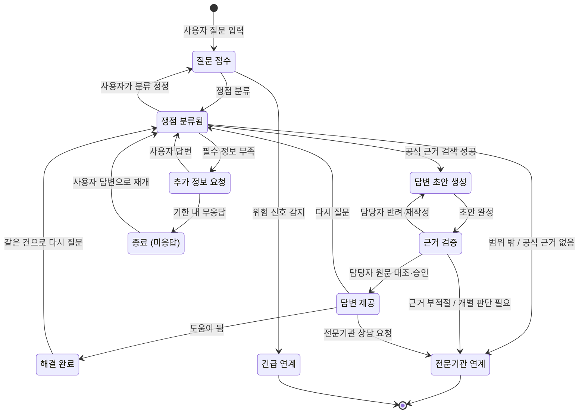
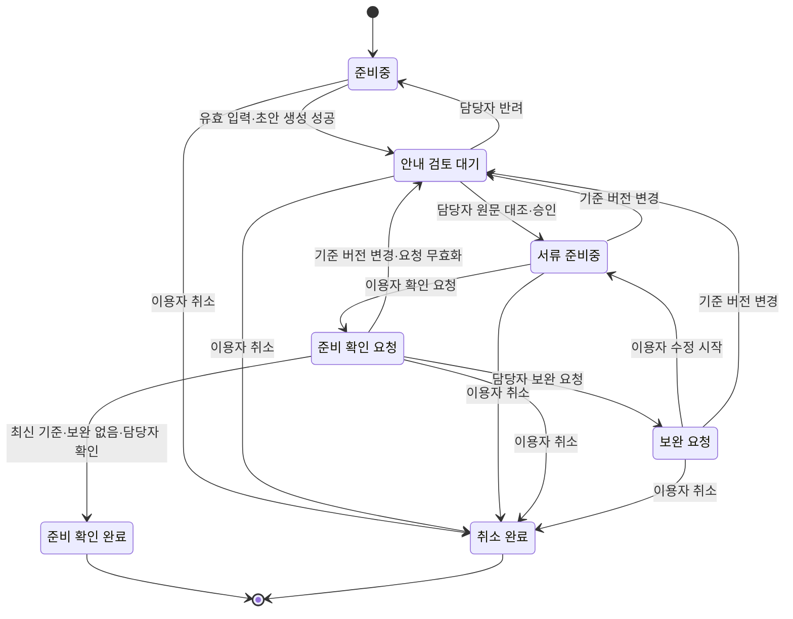

# 3. 규칙, 상태 전이, LLM이 들어갈 자리

> 목표: 클라이언트가 "이 경우엔요?"라고 물을 지점을 우리가 먼저 찾는다. 세부 주제의 필수 조건 두 가지(상태 전이, LLM)가 이 도메인의 어디에 들어갈 수 있는지 찾는다.

이 문서는 법률·제도 안내 도메인의 탐색 기록이다. 4단계에서 선정한 후보 B(체류기간 연장 준비)의 구체적인 상태·권한·담당자 검토 설계는 [4-2](../decisions/topic-selection.md#4-2-필수-조건-확인)에 정리했다. 아래 상담 흐름 전체를 B의 구현 범위로 해석하지 않는다.

## 3-1. 규칙 (최소 5개)

> 규칙은 '항상 / 절대 / ~이면 ~한다' 형태로 씁니다. 예외는 '그런데 만약 ~라면?'으로 찾습니다.
> 예: "배송중이 된 주문은 셀러가 취소할 수 없다" → 만약 고객이 배송중에 취소를 요청하면?

| 번호 | 규칙 | 예외·경계 사례 (만약 ~라면?) | 어기면 생기는 문제 | 태그 | 출처 (카드 번호) |
| --- | --- | --- | --- | --- | --- |
| R1 | 서비스는 **절대** 개별 사건의 체류·이혼·허가 결과를 단정하지 않고 공식 자료의 일반 설명과 준비 지원까지만 한다 | 만약 이용자가 체류 가능 여부를 예/아니오로 요구하면? → 개별 판단을 제공하지 않고 공식기관 확인 방법을 안내 | 검증 범위를 넘어선 결론을 이용자가 믿고 행동함 | `[가정]` 서비스 범위 규칙 | 4-4 제외 범위. 법률상 허용 범위를 검증한 주장과 구분 |
| R2 | 답변에는 **항상** 공식 출처와 기준일을 함께 보여 준다. 법령이면 법령명·조문 번호·시행일을, 행정 안내이면 기관명·원문 링크·확인일을 표시한다. 공식 근거를 찾지 못하거나 담당자 승인을 받지 못하면 답변을 제공하지 않는다 | 만약 법령이 아니라 행정 지침·하이코리아 안내문에만 있는 내용(예: 체류 연장 신청 가능 시점)이라면? → "법령이 아닌 행정 안내"라고 구분 표시 / 만약 질문 직후 법이 개정되었다면? | 출처 없는 답변을 사용자가 믿고 행동함. 틀린 답을 나중에 검증할 방법이 없음 | `[가정]` (서비스 규칙) | - |
| R3 | 체류기간을 초과해 계속 체류하려는 외국인은 체류기간이 끝나기 **전에** 연장허가를 받아야 한다는 공식 원칙을 안내한다 | 만약 심사 중이거나 휴일에 만료되면? → 제25조만으로 결론을 내리지 않고 담당기관의 공식 근거를 확인 | 기한과 심사 결과를 혼동해 잘못된 안내를 할 수 있음 | `[사실]` 기한 원칙. 예외·제재는 이 규칙에 포함하지 않음 | [2-Hyun731-03](cards/2-Hyun731-03.md), 2026-10-13 제25조 원문 재확인 |
| R4 | 지원하지 않는 체류 유형이나 개별 사건 판단 요청이면 **항상** 범위 밖임을 알리고 공식기관 확인을 안내한다 | 만약 혼인 유지 유형으로 시작한 뒤 이혼·폭력 등 다른 상황이 확인되면? → 해당 유형의 준비 완료로 처리하지 않음 | 적용되지 않는 목록으로 준비 완료를 잘못 표시함 | `[가정]` 서비스 범위 규칙 | 1-jhlarry1109-01의 유형 구분, 4-4 첫 범위 |
| R5 | 준비 확인 완료는 **항상** 최신 승인 목록의 미해결 보완이 없을 때 담당자만 처리한다. 민원 접수·허가 완료로 표시하지 않는다 | 만약 확인 요청 뒤 공식 기준이 바뀌면? → 요청을 무효화하고 안내 검토 대기로 되돌림 | 오래된 기준으로 완료하거나 준비 확인을 실제 허가로 오해함 | `[가정]` 서비스 상태·권한 규칙 | 4-2 후보 B의 전이 조건 |
| R6 | 사용자의 메시지에 폭력·위협·자해 같은 **위험 신호**가 있으면, 챗봇은 법률 설명보다 먼저 긴급 연락처를 안내한다 | 만약 위험 신호가 모국어 은어나 돌려 말한 표현이라 감지가 안 되면? / 만약 오탐이면? → 확인된 긴급 연락처를 즉시 안내한다. 현재 건은 긴급 안내로 종료하고, 추가 일반 질문은 새 건으로 받는다 | 위급 상황에서 법 설명만 길게 해서 도움을 놓침 | `[가정]` (서비스 규칙) | - |

## 3-2. 핵심 대상과 상태 전이

> **필수 조건입니다.** 세부 주제에는 상태가 바뀌는 핵심 대상이 반드시 있어야 합니다. 핵심 대상 후보를 찾아 상태를 적습니다.
>
> 기준:
> - 상태가 **4개 이상**이고, 처음 상태에서 끝 상태까지 순서가 있습니다.
> - 정상 경로 말고 **취소·반려·되돌림·실패 경로가 1개 이상** 있습니다.
> - 전이마다 **누가 바꾸는지, 어떤 조건에서 바꾸는지** 적을 수 있습니다.
>
> 도메인별 예시 (그대로 쓰지 말고 조사한 내용으로 바꿉니다):
>
> | 도메인 | 핵심 대상 | 상태 흐름 예시 |
> | --- | --- | --- |
> | 오픈마켓 셀러 운영 백오피스 | 주문 | 결제완료 → 상품준비중 → 배송지시 → 배송중 → 배송완료 (취소요청 → 취소완료, 반품요청 → 반품완료) |
> | 러닝 자세·훈련 코칭 | 주간 훈련 계획 | 계획됨 → 진행중 → 기록 제출 → 피드백 완료 (기록 부족 → 재측정 요청) |
> | 다문화 가정 행정 절차 안내 | 절차 진행 건 | 준비중 → 서류 확인 → 제출 완료 → 처리 완료 (서류 부족 → 보완 요청 → 서류 확인) |

**핵심 대상 후보**: 법률 질문 상담 건 (사용자가 한 가지 법률 문제로 시작한 질문 1건)

아래의 전문기관·긴급 연계는 확인된 연락처와 이용 방법을 안내하는 상태다. 외부기관 접수·실제 통화·상담 완료를 뜻하지 않는다. 자동 검사는 담당자의 검토를 보조하며, 답변은 담당자가 원문과 의미를 대조해 승인한 뒤 제공한다. 담당자 확보 여부는 4-5에서 검증할 가정으로 남긴다.

| 지금 상태 | 다음 상태 | 누가 바꾸나 | 조건 | 되돌릴 수 있나 | 태그 |
| --- | --- | --- | --- | --- | --- |
| (시작) | 질문 접수 | 사용자 | 사용자가 모국어로 질문을 입력함 | - | `[가정]` |
| 질문 접수 | 긴급 연계 | 시스템 (규칙) | 위험 신호 키워드·분류가 걸림 (R6) | 아니오 (끝 상태). 사용자가 원하면 새 상담 건으로 다시 시작 | `[가정]` |
| 질문 접수 | 쟁점 분류됨 | 시스템 (LLM 분류 → 규칙으로 확정) | 질문이 정해진 분야(체류·혼인/이혼·자녀·국적·노동·복지) 중 하나로 분류됨 | 예 (사용자가 "그게 아니에요"를 누르면 질문 접수로) | `[가정]` |
| 쟁점 분류됨 | 질문 접수 | 사용자 | 분류 결과를 보고 "그게 아니에요"로 정정을 요청함 | 예 | `[가정]` |
| 쟁점 분류됨 | 추가 정보 요청 | 시스템 (규칙) | 답에 꼭 필요한 정보(체류자격, 혼인 상태, 자녀 유무 등)가 빠짐 | 예 | `[가정]` |
| 추가 정보 요청 | 쟁점 분류됨 | 사용자 | 사용자가 빠진 정보에 답함 | 예 | `[가정]` |
| 추가 정보 요청 | 종료 (미응답) | 시스템 (시간) | 일정 기간 사용자가 답하지 않음 | 예 (다시 답하면 이어서 진행) | `[가정]` |
| 쟁점 분류됨 | 답변 초안 생성 | 시스템 (LLM) | 분류된 쟁점에 맞는 공식 법령·행정 안내를 찾음 | - | `[가정]` |
| 쟁점 분류됨 | 전문기관 연계 | 시스템 (규칙) | 지원 분야 밖이거나 공식 근거를 찾지 못함 | 아니오 (끝 상태) | `[가정]` |
| 답변 초안 생성 | 근거 검증 | 시스템 (규칙) | 초안이 만들어짐 | - | `[가정]` |
| 근거 검증 | 답변 제공 | 지원 담당자 | 공식 출처·버전을 확인하고 원문과 설명의 의미·인용·범위를 대조해 수정·승인함 (R1, R2). 자동 검사만으로 승인하지 않음 | - | `[가정]` |
| 근거 검증 | 답변 초안 생성 | 지원 담당자 | 오역·누락·잘못된 인용을 이유와 함께 반려하고 초안을 다시 작성하도록 요청함 | 예 | `[가정]` |
| 근거 검증 | 전문기관 연계 | 시스템 (규칙) | 공식 근거의 적절성을 확인하지 못하거나 개별 사건 판단이 필요한 질문임 (R1) | 아니오 (끝 상태) | `[가정]` |
| 답변 제공 | 해결 완료 | 사용자 | "도움이 되었어요"를 누름 | 예 (같은 건으로 다시 질문하면 쟁점 분류됨으로) | `[가정]` |
| 답변 제공 | 쟁점 분류됨 | 사용자 | "이해가 안 돼요 / 제 상황과 달라요"로 다시 질문 | 예 | `[가정]` |
| 답변 제공 | 전문기관 연계 | 사용자 | "전문기관과 상담하고 싶어요"를 누름 | 아니오 (끝 상태) | `[가정]` |
| 해결 완료 | 쟁점 분류됨 | 사용자 | 같은 문제로 다시 질문함 | 예 | `[가정]` |
| 종료 (미응답) | 쟁점 분류됨 | 사용자 | 빠진 정보에 다시 답함 | 예 | `[가정]` |

> 표를 다 채우면 아래처럼 그림으로도 그립니다. GitHub는 `mermaid` 코드 블록을 그림으로 보여 줍니다. 예시의 상태 이름과 화살표를 우리 내용으로 바꿉니다. 미리 보기는 GitHub의 파일 화면이나 편집 화면의 **Preview** 탭에서 확인합니다.

### 선정 주제 B의 상태 흐름

핵심 대상은 **절차 준비 건**이다. 전이별 담당자·조건은 [4-2의 전이 조건](../decisions/topic-selection.md#추천-후보-b의-전이-조건)과 동일하게 적용한다. 아래 그림의 정상·보완 경로를 5-1에서 처음부터 끝까지 시연한다. 준비 확인 완료는 민원 허가 완료가 아니다.

## 3-3. 시간에 따라 달라지는 규칙

> 기한, 마감, 주말·공휴일, 유효기간처럼 시간이 끼는 규칙을 1개 이상 적습니다. 3-2의 상태 전이와 이어지면 더 좋습니다.
> 예: 결제 후 ○영업일 안에 배송지시가 없으면 지연으로 표시한다 / 체류 기간 만료 ○일 전부터 연장 신청을 할 수 있다

| 규칙 | 기준 시간 | 주말·공휴일이면? | 태그 | 출처 (카드 번호) |
| --- | --- | --- | --- | --- |
| 체류기간 만료 전 연장허가 원칙을 안내한다. 신청 가능 시작일·휴일 예외·심사 중 체류를 자동 추론하지 않는다 | 체류기간 만료일 | 휴일 처리의 공식 근거 확인 없이 기한을 연장해 표시하지 않음 | `[사실]` 원칙, 나머지는 서비스 제한 | 2-Hyun731-03, 3-1 R3 |
| 공식 안내를 초안 생성 때와 담당자 최종 완료 때 최신 등록 버전과 비교한다. 달라졌으면 이전 확인 요청을 무효화하고 재검토한다 | 초안 생성 시각·완료 승인 시각 | 주말에도 동일한 버전 조건 적용. 검토자는 근무 시간에 승인 | `[가정]` 서비스 시간·버전 규칙 | 3-1 R2·R5, 4-2 재검토 전이 |
| 탐색안 A의 추가 정보 요청 후 7일간 미응답이면 종료(미응답)로 표시한다. 다시 답하면 쟁점 분류됨으로 재개한다 | 마지막 추가 정보 요청 시각 | 달력일 기준. 7일은 법정 기한이 아닌 설계값이며 B의 자동 취소 규칙으로 사용하지 않음 | `[가정]` 탐색안 A 설계값 | 3-2 미응답·재개 전이 |

## 3-4. LLM이 들어갈 자리

> **필수 조건입니다.** 세부 주제에는 LLM이 **서비스 기능 안에서** 쓰여야 합니다. 개발할 때 Claude를 쓰는 것은 여기에 해당하지 않습니다. 사용자가 서비스를 쓰는 동안 LLM이 무엇을 해 주는지 찾습니다.
>
> 좋은 자리를 고르는 기준:
> - 지금 사람이 **글을 읽고 쓰거나, 설명을 바꾸거나, 분류하는 데** 시간이 드는 곳 (2-2 As-Is의 문제 지점)
> - LLM이 틀려도 **사람이 확인하거나 규칙으로 걸러 낼 수 있는** 곳
> - 상태를 바꾸는 최종 결정은 **규칙이나 사람**이 하고, LLM은 초안·요약·분류·설명을 맡습니다
>
> 도메인별 예시:
>
> | 도메인 | LLM이 하는 일 | 사람이 확인하는 곳 |
> | --- | --- | --- |
> | 오픈마켓 셀러 운영 백오피스 | 고객 문의를 읽고 유형(취소·반품·배송 문의)을 분류하고 답변 초안 작성 | CS 담당이 고쳐서 보냄. 취소·반품 상태 변경은 규칙대로 |
> | 러닝 자세·훈련 코칭 | 러너가 남긴 훈련 기록과 느낌을 요약하고 다음 주 조정 제안 작성 | 코치가 승인해야 계획에 반영. 통증 언급은 의료 상담 권유로 |
> | 다문화 가정 행정 절차 안내 | 공식 안내문을 이용자의 언어와 쉬운 말로 바꾸고, 필요한 서류 목록을 뽑기 | 상담원이 원문과 비교해 확인. 법적 판단은 하지 않음 |

| 후보 | LLM에 넣는 것 (입력) | LLM이 내놓는 것 (출력) | 누가 보고 확인하나 | 틀리면 생기는 일 | 이어지는 상태 전이 | LLM에 보내면 안 되는 정보 (2-3 개인정보) |
| --- | --- | --- | --- | --- | --- | --- |
| L1 | 사용자의 모국어 질문 + 앞선 대화 요약 | 쟁점 분야 분류(체류·혼인/이혼·자녀·국적·노동·복지·긴급), 답에 필요한데 빠진 정보 목록 | 규칙: 분류 결과가 정해진 목록 밖이면 버림. 사용자: 분류 결과를 보고 "그게 아니에요"로 정정 | 엉뚱한 법을 찾아 틀린 답이 나감. 위험 신호를 놓치면 긴급 연계가 안 됨 (→ 키워드 규칙을 함께 써서 보완) | 질문 접수 → 쟁점 분류됨 / 추가 정보 요청 / 긴급 연계 | 이름, 외국인등록번호·여권번호, 전화번호, 주소, 배우자·자녀 실명 (입력 단계에서 가림 처리 후 전송) |
| L2 | 분류된 쟁점 + 공식 법령·행정 안내 원문과 버전 + 사용자 상황 요약(개인 식별 정보 제외) | 사용자 언어로 쓴 쉬운 설명 답변 초안, 인용한 조문 목록, 다음에 할 일(어느 기관에 무엇을 가져가는지) | 규칙: 공식 출처·인용·단정 표현을 자동 검사 (R1, R2). 담당자: 모든 답변의 원문·번역 의미·범위를 대조해 수정·승인한 뒤 제공. 사용자: 원문 보기와 정정 요청. 표본 검토는 사전 승인을 대신하지 않음 | 없는 조문을 지어내거나(환각) 번역이 틀려 사용자가 잘못 행동함 → 검증에서 걸리면 전문기관 연계로 | 답변 초안 생성 → 근거 검증 → 답변 제공 / 전문기관 연계 | 위와 같음 + 가정폭력 피해 내용·건강 정보. 탐색안에서도 해당 내용은 LLM 전송에서 제외하고 공식기관 안내로 전환 |
| L3 | 이용자가 요약 대상으로 선택하고 식별정보를 제거한 상담 내용 | 상담원용 한국어 요약 (쟁점, 사용자가 이미 들은 안내, 남은 질문) | 이용자와 우리 서비스 담당자가 선택된 원문과 비교. 외부기관 수신·검토 협조는 미확인 | 요약 오류로 상황 전달이 달라질 수 있음. 이용자·담당자 검토 후 상담 준비 자료로 제공하며 원문·요약을 외부기관에 자동 전송하지 않음 | 전문기관 연계 (끝 상태에서 쓰는 보조 기능) | 연계에 꼭 필요하지 않은 식별 정보 (사용자 동의 없이 넘기지 않음) |
| L4 (선정 B) | 담당자가 등록한 공식 안내·버전, 선택된 지원 유형·언어 | 쉬운 다국어 설명·준비 항목 초안 | 담당자가 모든 초안을 원문과 대조해 수정·승인. 필수 목록·완료 판단은 규칙·사람이 담당 | 오역·누락으로 잘못 준비할 수 있어 승인 전 이용자 제공 금지. 생성 실패는 준비중 유지 | 준비중 → 안내 검토 대기 → 서류 준비중. 반려는 준비중으로 | 실명·연락처·등록번호·여권번호·주소·실제 서류 이미지. 가상 사례와 허용된 비식별 입력만 사용 |

## 3-5. 법령·통계·보고서로 확인하기

> 팀 합계 3개 이상. 3-1 규칙과 ⑤ 손해처럼 근거가 약한 내용을 자료로 확인합니다. 이 중 1개 이상은 `[추정]`·`[가정]`을 `[사실]`로 바꾸거나, 반대로 틀렸다는 것을 확인한 것이어야 합니다.
> 자료마다 [카드](cards/_template.md)를 한 장씩 만들고, 여기에는 목록만 적습니다. 조항 번호나 숫자는 카드에 자료에 적힌 그대로 옮깁니다.

기존 카드의 확인 결과를 연결하고, 2026-10-13 출입국관리법 제25조·다문화가족지원법 제2조·재한외국인 처우 기본법 제2조와 공식 서비스 안내를 재확인했다. 팀원들의 독서 기록은 대신 작성하지 않는다. 법령 3개와 기존 통계 보고서를 구분하며 서비스 문서는 별도 보조 근거로 센다.

| 자료 종류 | 카드 번호 | 자료명 (짧게) | 확인한 내용 요지 | 태그 변화·한계 | 반영한 표 |
| --- | --- | --- | --- | --- | --- |
| 법령 | [2-Hyun731-03](cards/2-Hyun731-03.md) | 출입국관리법 제25조 | 기존 카드가 만료 전 연장허가 원칙을 원문에서 확인 | 기한 원칙만 `[추정]` → `[사실]`. 예외·제재는 R3에서 제외하여 미확인 내용을 사실로 묶지 않음 | 3-1 R3, 3-3 기한 규칙 |
| 통계·보고서 | [5-Hyun731-01](cards/5-Hyun731-01.md), [5-jhlarry1109-01](cards/5-jhlarry1109-01.md) | 2024년 전국다문화가족실태조사 | 언어·기관 이용 어려움의 배경을 확인 | 생활 어려움의 배경은 `[사실]`; F-6 서류 누락·손해는 `[가정]`. 같은 조사의 보고서·요약이므로 별도 조사 2건으로 세지 않음 | 4-1 후보 근거, 4-4 문제 배경 |
| 서비스 문서 | [1-jhlarry1109-01](cards/1-jhlarry1109-01.md) | 정부24 체류기간연장허가 안내 | 유형별 준비 항목과 공식 기관 접점 | 공식 안내 존재는 `[사실]`; B의 준비 상태·권한은 `[가정]` | 4-2 후보 B, 4-4 기존 해결 수단 |
| 서비스 문서 | [4-jhlarry1109-01](cards/4-jhlarry1109-01.md) | 다누리콜센터 운영 안내 | 기존 상담·통번역 지원 | 지원 존재는 `[사실]`; 대기·반복 설명·외부 자동 연계는 미확인 | 3-4 L3, 4-1 후보 C |

법령·통계·보고서 3개 요건에는 서비스 문서를 대신 세지 않는다. 추가 법령은 [2-Hyun731-01](cards/2-Hyun731-01.md)(다문화가족지원법 제2조), [2-Hyun731-02](cards/2-Hyun731-02.md)(재한외국인 처우 기본법 제2조)에 기록되어 있으며 1-2·2-3의 대상 구분을 뒷받침한다. 이 정의 조문들이 아래의 기한·제재까지 검증한 것은 아니다.

첫 MVP에서 다루지 않는 혼인 단절·출생신고·외국인등록·체류지 신고의 구체적 법률 판단, 신청 가능 시작일, 외부 법령 API 자동 연동은 구현 범위에서 제외한다. 기존 미확인 예시를 운영 규칙으로 사용하지 않는다. 필요한 경우 5단계 질문과 공식기관 확인을 거쳐 범위 변경을 기록한다.
