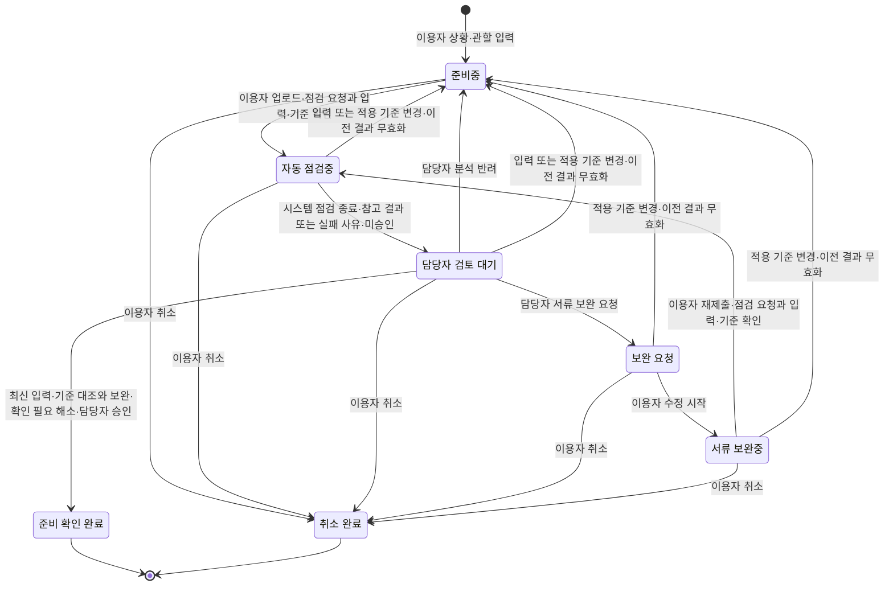

# 다문화가족 체류 행정 준비 도우미 — 프로젝트 제안서 초안

> 2026-10-13 조사 기반 초안에 2026-10-19 클라이언트 미팅을 반영한 수정본입니다(수정일: 2026-10-20). 문장 끝 `(출처: 02 2-2)`는 바탕 파일과 표 번호, `[B번호]`는 부록 B 참고 자료입니다. ‘피드백 번호’의 출처는 [클라이언트 미팅 1 기록](../interview/client-meeting-1.md)의 ‘받은 피드백과 처리’ 표입니다. `[사실: 클라이언트 발언]`은 기록에서 확인한 발언·요구이며 도메인 전체의 사실을 뜻하지 않습니다. 제안 기능·운영 방식·개선 효과는 `[가정]`입니다. 기존 조사 문서와 달라진 범위는 이 수정본에 명시했으며, 외부 자료를 새로 검증하거나 팀 승인을 받은 상태는 아닙니다.

| 항목 | 내용 |
| --- | --- |
| 프로젝트명 | `[가정]` 다문화가족 체류 행정 준비 도우미 (출처: topic-selection 4-4) |
| 한 줄 부제 | 상황 설명과 업로드 서류를 공식 기준에 대조해 주의점·추가 서류를 안내하고 담당자가 최종 확인하는 체류기간 연장 준비 도우미 `[가정]` (출처: 피드백 1·6~11 반영 설계) |
| 제안 팀 | multicultural-families (저장소 식별명) (출처: README 팀 표) |
| 도메인 | 다문화 가정의 한국 생활·법률·제도 정보 이용 (출처: README 팀 표) |
| 제출일 | 2026-10-13 (팀 결정) |
| 팀원 | 김민건, 권길현, 김태후, 여철준, 이주환 (출처: team/roles.md) |
| 팀 저장소 | https://github.com/rulrularla123/multicultural-families |

## 제안 요약

| 항목 | 내용 |
| --- | --- |
| 서비스 한 줄 정의 | `[가정]` 결혼이민자의 상황 설명과 업로드 서류를 공식 공통 기준과 확인된 관서별 추가 기준에 대조해 주의점·추가 서류를 안내하고, 모든 준비 건을 담당자가 최종 검토·승인하는 체류기간 연장 준비 도우미. 한국인 배우자와 한국어·모국어로 함께 본다. (출처: Ⅰ-3, Ⅳ-9~13) |
| 해결할 문제 | `[사실: 클라이언트 발언]` 알맞은 서류를 고르는 데 가장 많은 시간이 들고, 관서별 추가 서류는 보통 관서에 전화해 확인한다고 말했다. 전체 이용자의 공통 경험·소요 시간·누락 빈도는 아직 확인하지 않았다. (출처: 미팅 기록 피드백 10·13, Ⅱ-4) |
| 핵심 기능 3가지 | `[가정]` F-03 업로드 서류·공식 기준 대조 / F-09 부재 시간 자동 점검·검토 필요 표시 / F-04 서류 분석 결과 검토·승인·반려. 두 언어 병렬 표시는 F-10으로 지원한다. (출처: Ⅳ-11) |
| 기대 효과 | `[가정]` 이용자의 서류 선택·준비 시간과 담당자의 검토·반복 안내 시간 단축, 필수 서류 누락 감소. 자동 점검과 승인 대기를 구분해 측정하며, 기준선과 실제 절감 효과는 미측정이며 수치 목표는 미정이다. (출처: Ⅴ) |
| 고객께 요청드리는 것 | 후속 질문 3가지로 대상 서류·검토 항목과 측정 기준선, AI 이관 조건·건별 승인 운영·두 언어 표시 범위, 공통·관서별 기준 갱신 책임·실제 서류 처리 조건을 확인해 주시기. (출처: Ⅶ-18) |

## Ⅰ. 제안 개요

### 1. 제안 배경

**도메인 현황**

결혼이민자·귀화자의 한국생활 어려움 중 언어 문제는 2024년 20.3%, 공공기관·은행 이용은 3.7%로 조사되었다(복수응답) `[사실]`[B3]. 체류기간을 넘어 계속 체류하려는 외국인은 만료 전에 연장허가를 받아야 하며 `[사실]`[B4], 정부24는 체류 유형(F-6 가·나·다목 등)에 따라 제출 서류를 구분해 안내한다 `[사실]`[B1]. 다누리콜센터는 생활정보·법률자문·통번역을 365일 24시간 지원한다 `[사실]`[B2]. 이 통계는 언어·기관 이용의 어려움이 있다는 배경이며, F-6-1 이용자의 연장 준비 문제나 손해를 직접 증명하지 않는다. (출처: 3-5, topic-selection 작성 상태 표, 5-jhlarry1109-01)

**근거**

| 번호 | 근거 (자료에 적힌 내용) | 태그 | 출처 |
| --- | --- | --- | --- |
| 1 | 결혼이민자·귀화자의 지난 1년간 한국생활 어려움(복수응답): 언어 문제 2021년 22.9% → 2024년 20.3%, 공공기관·은행 이용 2021년 6.1% → 2024년 3.7% | `[사실]` | [B3] |
| 2 | 체류기간을 초과해 계속 체류하려는 외국인은 체류기간이 끝나기 전에 연장허가를 받아야 한다 (출입국관리법 제25조제1항) | `[사실]` | [B4] |
| 3 | 부산·경남 여성 결혼이민자 136사례(2008) 중 기관에 정보·서비스를 요청하지 않은 이유로 "기관 존재를 몰랐다"가 사례 기준 74.6%. 오래된 지역 연구로 현재 전체 비율로 일반화하지 않음 | `[사실]` | [B5] |

(출처: 2-5, 3-5, cards)

### 2. 제안 목적

| 번호 | 목적 |
| --- | --- |
| 1 | 이용자가 상황을 설명하고 서류를 올리면 공식 기준과의 대조 결과에서 주의점·누락 가능 항목·추가 서류를 파악해, 알맞은 서류를 고르는 시간을 줄인다. `[가정]` (출처: 피드백 9~11 반영 설계) |
| 2 | 결혼이민자와 한국인 배우자가 한국어·모국어 병렬 화면에서 같은 분석 결과와 보완 사유를 보고 서류를 수정·재제출한다. `[가정]` (출처: 피드백 11·12 반영 설계) |
| 3 | AI 대조 결과와 근거를 담당자에게 정리해 주어 건별 검토에 드는 시간을 줄이되, 모든 준비 건의 최종 승인·완료 판단은 담당자가 맡는다. `[가정]` (출처: 피드백 1·5·9 반영 설계) |

### 3. 제안 범위

| 항목 | 내용 |
| --- | --- |
| 대상 사용자 | `[가정]` 주 사용자는 체류기간 연장을 준비하는 결혼이민자와 함께 화면을 보는 한국인 배우자다. 첫 범위는 기존 제안의 혼인 유지 중인 F-6-1 한 유형을 유지하되 적합성은 추가 확인한다. 보조 사용자는 서류 분석 결과를 검토·승인하는 지원 담당자이며 참여 가능 여부는 미확인이다. 배우자의 별도 계정·대리 권한은 자동 부여하지 않는다. (출처: 4-4, 피드백 1·12 반영 설계) |
| 이번에 하는 것 | `[가정]` 상황 설명·관할 관서 확인·서류 업로드 → 공통 기준과 확인된 관서별 추가 기준으로 AI 대조 → 주의점·추가 서류 참고 결과 → 담당자 검토·승인 또는 보완 요청 → 수정·재분석 → 준비 확인 완료. 담당자 부재 중에도 자동 점검하며 ‘담당자 검토 필요’를 표시한다. 한국어와 모국어 1개를 함께 보여 준다. 첫 데모는 가상 상황과 모의 서류 이미지로 업로드부터 승인까지 시연한다. (출처: 피드백 1·4·9·11~13 반영 설계) |
| 이번에 하지 않는 것과 이유 | 다른 법률 분야·모든 체류 유형, 민원 제출·예약·허가 조회, 개별 사건의 법적 판단, 서류 진위·위변조 판정, 외부기관 자동 전송, 서류의 무기한 보관은 제외한다. 서류 업로드·내용 읽기와 기준 대조는 포함한다. 실제 서류 운영에 필요한 동의·접근·마스킹·보관·삭제 조건은 Ⅶ-16 H4와 Ⅶ-18에서 확정하며, 확인 전 데모는 모의 서류로 진행한다. 준비 확인 완료는 민원 접수·허가 완료가 아니다. `[가정]` (출처: 기존 4-4 제외 범위, 피드백 11 반영 범위 변경) |

## Ⅱ. 현황 분석

### 4. 현재 방식과 문제점

**관련된 사람**

| 사용자 | 하는 일 | 지금 가장 큰 불편 |
| --- | --- | --- |
| 결혼이민자 | 상황에 맞는 서류를 골라 체류기간 연장을 준비 | `[사실: 클라이언트 발언]` 알맞은 서류를 고르는 데 시간이 가장 많이 든다고 설명했다(피드백 10). 전체 이용자의 공통 경험·실제 소요 시간은 미확인이다. 한국어 법령 용어의 어려움은 기존 `[추정]`이며 언어 문제 통계[B3]와 구분한다. |
| 한국인 배우자 | 결혼이민자와 함께 화면을 보며 상황·서류를 확인 | `[사실: 클라이언트 발언]` 한국인 배우자도 함께 볼 수 있는 두 언어 동시 표시를 요청했다(피드백 12). 실제 역할 분담·별도 접근 권한은 추가 확인한다. |
| 지원 담당자 (가족센터 등) | 상황과 서류를 기준에 대조하고 보완·승인 | `[사실: 클라이언트 발언]` 담당자 투입 시간 절감을 요구했다(피드백 5). 상황 파악·기준 조회·검토 중 어느 작업이 얼마나 걸리는지는 미측정이다. |
| 상담원·통번역사 (다누리콜센터 등) | 전화·방문 상담, 3자 통화 통역, 기관 연계 | 지원 존재는 `[사실]`[B2]. 법률 용어 전달과 반복 설명의 부담은 기존 `[가정]`이며 이번 피드백으로 발생 빈도가 확인된 것은 아니다. (출처: 02 2-1) |

**지금 일하는 순서 (As-Is)**

| 단계 | 누가 무엇을 하나 (쓰는 도구) | 막히는 곳 |
| --- | --- | --- |
| 1 | 결혼이민자·배우자가 포털에서 검색 (포털, 블로그, 지식 Q&A) | `[가정]` 광고성 글이 섞이고 내 체류자격에 맞는 내용인지 판단하기 어려움 (출처: 02 2-2 2번) |
| 2 | 결혼이민자·배우자가 공식 사이트에서 제도와 제출 서류를 찾아 읽음 (하이코리아, 정부24 등) | `[사실: 클라이언트 발언]` 알맞은 서류를 고르는 단계에 시간이 가장 많이 든다고 설명함(피드백 10). 구체적인 서류·시간은 미확인. 법령·행정 용어의 어려움은 기존 `[추정]` (출처: 02 2-2 3번) |
| 3 | 결혼이민자가 상담원·통번역사와 전화·방문 상담 (다누리콜센터, 가족센터 등) | `[가정]` 상황 설명을 반복할 수 있음. 지역센터·방문상담의 일정 제약과 다누리콜센터의 24시간 지원을 구분함 (출처: 02 2-2 5번, [B2]) |
| 4 | 이용자·담당자가 관할 출입국·외국인관서에 전화해 추가 서류를 확인 | `[사실: 클라이언트 발언]` 관서마다 추가 서류가 있어 직접 전화한다고 설명함(피드백 13). 관서별 실제 목록·공식 근거·적용 조건은 아직 수집하지 않음. |
| 5 | 결혼이민자·배우자가 서류를 준비해 관서에 신청 | `[추정]` 서류 누락 시 재방문·기한을 놓칠 위험. 만료 전 연장허가 원칙은 기존 `[사실]`[B4]이며, 재방문 빈도는 미확인 (출처: 02 2-2 6번) |

위 순서는 기존 조사 흐름에 피드백 10·13을 반영해 재구성한 것으로, 한 이용자의 전 과정을 관찰한 기록은 아니다.

**이 문제로 생기는 손해**

`[사실: 클라이언트 발언]` 알맞은 서류를 고르는 데 가장 많은 시간이 들고(피드백 10), 관서별 추가 서류를 전화로 확인한다고 설명했다(피드백 13). 이는 해당 발언이 전달되었다는 근거이며 모든 F-6-1 이용자의 경험을 입증하지 않는다. `[가정]` 서류 선택·기준 조회·담당자 확인에 드는 시간을 줄일 여지가 있다. 건당 시간, 발생 빈도, 누락·재방문·비용 손실은 미측정이다. Ⅴ의 비교 측정과 Ⅶ-18 후속 질문에서 기준선·사례를 확인한다. 언어 문제 20.3%(2024)[B3]를 서류 누락·재방문 비율로 해석하지 않는다.

### 5. 기존 서비스 분석

| 기존 서비스 | 잘하는 것 | 해결하지 못한 것 |
| --- | --- | --- |
| 정부24 체류기간연장허가 안내 | 체류 유형별 서류·기관 접점을 구분해 공식 기준·근거법령을 안내 `[사실]`[B1] | `[사실: 클라이언트 발언]` 관서별 추가 서류는 전화로 확인한다고 설명했다(피드백 13). `[가정]` 공통 안내에 더해 해당 관서의 확인된 기준과 내 서류를 대조할 필요가 있다. 정부24가 모든 관서의 추가 기준을 제공하지 않는다는 사실까지 확인한 것은 아니다. |
| 다누리콜센터 | 생활정보·법률자문·3자 통화 통역·긴급지원을 365일 24시간 제공 `[사실]`[B2] | `[가정]` 서류 대조 결과·보완 이력 관리가 추가 가치를 줄 수 있다. 기존 서비스에 이 기능이 전혀 없다는 조사 근거는 없으며 대기·반복 설명과 외부기관 자동 연동도 미확인이다. (출처: 02 2-4, 피드백 6~9 반영 검증 과제) |

| 시사점 | 내용 |
| --- | --- |
| 가져갈 점 | 유형별 공식 기준·출처 표시와 기존 사람 상담·통번역 지원을 활용한다. 관서 추가 기준은 출처·확인일·적용 조건을 확인해 공통 기준과 구분한다. `[가정]` (출처: 02 2-4, 피드백 13 반영 설계) |
| 다르게 할 점 | 번역 중심 안내에서 상황·업로드 서류의 기준 대조와 담당자 검토 보조로 초점을 바꾼다. 부재 시간 자동 점검은 미승인 참고 결과로 표시하고, 시간 절감과 기존 서비스 대비 가치는 따로 측정한다. `[가정]` (출처: 피드백 1·4~11) |

## Ⅲ. 세부 주제 선정 과정

### 6. 검토한 문제 후보

| 후보 | 누구의 어떤 문제인가 (한 문장) | 근거 |
| --- | --- | --- |
| A. 다국어 법률·제도 안내 | `[추정]` 결혼이민자가 체류·혼인·자녀 등의 질문을 자신의 언어로 이해할 공식 설명과 연결하기 어려워 다음 행동을 정하지 못한다. | 02 2-2 2·3번, 03 3-1 R1·R2, 3-4 L1·L2. 배경 [B3], 기존 도움 [B2] |
| B. 체류기간 연장 준비 지원 | `[추정]` 결혼이민자가 자신의 유형에 맞는 공식 안내와 준비 항목을 이해하기 어려워 무엇을 준비했고 무엇이 부족한지 파악하기 어렵다. | 02 2-2 3·6번, 03 3-1 R2·R3, 3-4 L4. 배경 [B3], 유형별 서류 [B1], 접근 장벽 [B5] |
| C. 전문상담 연결 준비 지원 | `[가정]` 결혼이민자가 어느 기관에 무엇을 설명할지 정리하기 어려워 상담 준비에 시간이 들고, 상담원은 상황을 다시 파악해야 한다. | 02 2-2 5번, 03 3-2 전문기관 연계, 3-4 L3. 배경 [B3](상담 이용 경험 5.5%), 기존 기관 [B2] |

(출처: topic-selection 4-1)

### 7. 선정 기준과 평가

| 후보 | 상태 전이 있음 | LLM 자리 있음 | 점수 합계 | 결정적이었던 기준 |
| --- | --- | --- | --- | --- |
| A | ○ | ○ | 13 | ⑤ 8주 MVP 가능성 1점 — 다분야 질문과 법률 검토를 동시에 다뤄 범위가 큼 |
| B | ○ | ○ | 17 | ① 규칙 명확성·③ 상태·권한·⑤ MVP 가능성 3점 — 한 절차의 승인·보완·취소·버전 변경을 테스트로 쓸 수 있음 |
| C | ○ | ○ | 15 | ④ 외부 접점 2점·⑤ MVP 2점 — 기관 연동과 설명 부담 감소 효과 미확인 |

점수는 ①~⑥ 합계이며 `[추정]`인 비교 점수다. ⑦ 팀의 흥미는 실제 응답이 없어 제외했다. (출처: topic-selection 4-2, 4-3)

### 8. 최종 선정 이유

Ⅲ-6·7은 2026-10-13 당시의 후보 비교·점수 기록이다. 아래는 그 뒤 전달된 클라이언트 피드백에 따른 방향 전환이며, 기존 점수를 서류 업로드·분석 기능의 재평가 점수로 사용하지 않는다.

| 항목 | 내용 |
| --- | --- |
| 최초 선정 | B. 체류기간 연장 준비 지원. 당시 ①~⑥ 소계 17점으로, 한 절차의 준비·보완·완료를 테스트로 설명하기 쉽다고 판단했다. (출처: 4-3, 4-5) |
| 방향을 바꾼 계기 | `[사실: 클라이언트 발언]` 현재 시스템이 단순 번역에 그치고 어필할 가치가 부족하다는 평가와 자동화·상황 설명 기반 서류 안내 요청이 있었다(피드백 6~9·11). 알맞은 서류를 고르는 데 시간이 가장 많이 든다고도 말했다(피드백 10). 미팅 기록의 ‘여전히 가정인 것’에는 이를 상황·업로드 서류 대조로 구체화한 서비스안이 정리돼 있다. 업로드 검토의 유용성·구현 가능성까지 확인된 것은 아니다. |
| 수정한 주제와 선정 이유 | `[가정]` 체류기간 연장이라는 대상 절차는 유지하되, 서비스 중심을 ‘쉬운 다국어 안내’에서 ‘상황·업로드 서류를 공통·관서별 기준과 대조하고 담당자가 승인하는 준비 지원’으로 전환한다. 이용자의 서류 선택 시간과 담당자의 투입 시간을 줄이는지를 검증한다. 업로드·분석의 구현 가능성과 기준·검토자 확보는 추가 검증이 필요하다. (출처: 피드백 1·5·9~13 반영 설계) |
| 고르지 않은 후보와 이유 | `[추정]` A는 다분야 법률 설명·검토 범위가 크고, C는 상담 준비 요약의 추가 가치가 미확인이라는 기존 판단을 유지한다. (출처: 4-4) |
| 같은 도메인 팀과 겹침 조정 | 2026-10-13 당시 팀 확인에서는 다른 팀과 겹치지 않았다. 서류 검토로 바뀐 범위의 겹침 여부는 재확인이 필요하다. |

## Ⅳ. 제안 내용

### 9. 서비스 개요

| 항목 | 내용 |
| --- | --- |
| 서비스 이름 | `[가정]` 다문화가족 체류 행정 준비 도우미 (출처: 4-4) |
| 한 줄 정의 | `[가정]` 결혼이민자의 상황 설명과 업로드 서류를 공식 기준과 대조해 주의점·추가 서류를 안내하고, 모든 준비 건을 담당자가 최종 검토·승인하는 체류기간 연장 준비 서비스. (출처: 피드백 1·6~11, 미팅 기록 ‘여전히 가정인 것’) |
| 핵심 가치 | `[가정]` ① 공통·관서별 기준에 따른 서류 대조와 보완 안내로 이용자의 서류 선택·준비를 돕는다 ② 담당자에게 근거·주의점·보완 이력을 정리해 검토·반복 안내 시간을 줄인다 ③ 결혼이민자와 한국인 배우자가 한국어·모국어를 함께 본다. (출처: 피드백 5·9~14 반영 설계) |
| 차별점 | `[가정]` 공식 출처·기준 버전을 연결한 서류 검토 보조, 담당자 부재 중 자동 점검과 승인 대기 구분, 보완 이력 관리. 번역은 공동 이해를 돕는 보조 기능이다. 기존 서비스 대비 추가 가치와 시간 절감은 미검증이며 준비 확인 완료는 민원 허가가 아니다. (출처: 02 2-4, 피드백 1·4~14 반영 설계) |

### 10. 목표 흐름 (To-Be)

| 순서 | 사용자가 하는 일 | 서비스가 해 주는 일 | As-Is와 달라진 점 |
| --- | --- | --- | --- |
| 1 | 이용자가 상황·관할 관서를 설명하고 준비 건을 만든다 (**준비중**) | 첫 지원 범위에 맞는 상황 입력 예시와 서류 안내를 제공한다. 필요한 시작 템플릿은 후속 확인한다 | 유형·언어 선택만으로 시작하던 흐름에서 상황 설명으로 전환 |
| 2 | 이용자가 서류를 올리고 분석을 요청한다 (**자동 점검중**) | 공통 기준과 확인된 관서별 추가 기준을 찾아 서류 내용과 대조하고 출처·적용 버전을 기록한다 | 직접 안내를 찾아 서류와 대조하는 부담을 줄일 수 있는지 검증 |
| 3 | 이용자·배우자가 결과와 보완 사유를 두 언어로 함께 확인한다 | 주의점·누락 가능 항목·추가 서류를 ‘미승인 참고 결과·담당자 검토 필요’로 표시한다 (**담당자 검토 대기**). 공개 범위는 후속 확인할 설계안이다 | 준비 여부 체크 대신 상황·서류에 근거한 설명을 제공 |
| 4 | 담당자 부재 중에도 이용자가 점검을 요청할 수 있다 | 시스템이 같은 자동 점검을 수행하되 승인으로 처리하지 않는다. 판독 실패·근거 부족·관서 기준 불명은 확인 필요 사유와 함께 담당자에게 넘긴다 | 부재 중에도 확인할 항목을 정리하고 승인 대기와 구분 |
| 5 | 담당자가 분석 결과·서류·기준을 대조해 보완 요청 또는 반려한다 | 부족 항목·이유를 기록한다 (**보완 요청**). 이용자는 상황·서류를 수정하고 재분석을 요청한다 (**서류 보완중 → 자동 점검중**) | 보완 내용·재제출 이력이 다음 검토로 이어짐 |
| 6 | 담당자가 최신 상황·서류·기준의 대조 결과와 보완 해결 여부를 확인한다 | 모든 준비 건에서 담당자의 최종 승인으로만 **준비 확인 완료**가 된다. 오류 결과는 반려하고 기준 변경 시 재점검한다 | 준비 확인과 민원 접수·허가를 구분하며 승인 책임을 유지 |

위 흐름은 모두 `[가정]`인 설계안이다. 담당자는 서비스의 지원 담당자이며 출입국기관의 허가 담당자와 다르다. (출처: 기존 4-2·5-1의 승인·보완 원칙, 피드백 1·3~14, 미팅 기록 ‘여전히 가정인 것’)

### 11. 주요 기능 목록

| ID | 기능명 | 설명 | 사용자 | 우선순위 | 관련 상태 / LLM |
| --- | --- | --- | --- | --- | --- |
| F-01 | 상황 입력·준비 건 생성·본인 접근 | 상황·관할 관서·사용 언어를 입력해 본인 건을 만든다. 첫 지원 유형은 F-6-1로 제한하며 적합성은 추가 확인한다. 이용자는 본인 건만 조회·수정하고 승인 기능은 쓸 수 없다 | 이용자·담당자 | 필수 | 시작 → 준비중 / LLM 없음 |
| F-02 | 공통·관서별 기준 버전 관리 | 담당자가 공통 기준과 관서별 추가 기준을 나누어 출처·확인일·적용 조건·버전을 등록한다. 미확인 기준은 확정 항목으로 쓰지 않는다. 적용 기준 변경 시 진행 건의 기존 분석·승인 요청을 무효화하고 재점검한다 | 담당자·시스템 | 필수 | 자동 점검중·담당자 검토 대기·보완 요청·서류 보완중 → 준비중 / LLM 없음 |
| F-03 | 업로드 서류·공식 기준 대조 | 상황 설명과 업로드 서류를 확인된 기준에 대조해 주의점·누락 가능 항목·추가 서류·확인 질문의 초안을 만든다. 판독·분석 실패와 근거 부족을 표시한다 | 시스템·담당자 | 필수 | 자동 점검중 → 담당자 검토 대기 / LLM ○ |
| F-04 | 서류 분석 결과 검토·승인·반려 | 담당자가 서류 내용·분석 결과·근거·보완 해결 여부를 대조한다. 오류 결과는 이유와 함께 반려하고 모든 건의 최종 승인을 직접 수행한다 | 담당자 | 필수 | 담당자 검토 대기 → 준비중 / 준비 확인 완료 / LLM 결과를 사람이 검토 |
| F-05 | 서류 업로드·상황 수정·재분석 요청 | 서류 이미지·문서와 상황 설명을 제출·수정한다. 서류 내용 읽기는 포함하며 진위 판정은 제외한다. 입력 변경 시 이전 결과로 승인할 수 없다 | 이용자 | 필수 | 준비중·서류 보완중 → 자동 점검중, 자동 점검중·담당자 검토 대기의 입력 변경 → 준비중 / LLM 입력 제공 |
| F-06 | 보완 요청·재제출 이력 | 담당자가 부족 항목과 이유를 지정하고 이용자가 서류·상황을 보완한다. 재분석 뒤 다시 담당자 검토를 받는다 | 이용자·담당자 | 필수 | 담당자 검토 대기 → 보완 요청 → 서류 보완중 → 자동 점검중 / LLM 없음 |
| F-07 | 진행 이력·취소 | 상황·서류·적용 기준 버전과 분석·반려·보완·승인 이력을 연결한다. 진행 중 본인 건을 취소할 수 있다. 완료·취소 건은 수정하지 않는다 | 이용자·담당자 | 필수 | 진행 중 5개 상태 → 취소 완료 / LLM 없음 |
| F-08 | 대기·보완 알림 | 화면에 대기·보완 사유를 표시한다. 동의한 채널의 외부 알림은 후순위로 둔다 | 이용자·담당자 | 선택 | 상태를 바꾸지 않음 / LLM 없음 |
| F-09 | 부재 시간 자동 점검·검토 필요 표시 | 담당자 부재 여부와 관계없이 F-03과 등록된 점검 규칙으로 누락·기재 이상 후보를 정리한다. 시스템은 결과 또는 실패 사유를 검토 대기로 보내고 ‘미승인·담당자 검토 필요’를 표시한다. 자동 완료는 하지 않는다 | 시스템·이용자·담당자 | 필수 | 자동 점검중 → 담당자 검토 대기 / LLM 보조, 승인 권한 없음 |
| F-10 | 한국어·모국어 병렬 표시 | 상태·서류 대조 결과·주의점·추가 서류·보완 사유를 한국어와 모국어 1개로 함께 제공한다. 미승인 표시와 근거를 양쪽에 유지한다. 배우자 별도 접근 권한은 부여하지 않는다 | 이용자·한국인 배우자·담당자 | 필수 | 상태를 바꾸지 않음 / LLM은 설명·번역 보조 |

모두 `[가정]`인 수정 기능안이다. 기존 5-2의 기능 ID를 유지하되 내용을 바꾸고 F-09·10을 추가했다. 실제 서류 운영 시 동의·접근·마스킹·보관·삭제 조건은 Ⅶ-16 H4에서 확인한다. 첫 데모에는 모의 서류를 사용한다. (출처: 피드백 1·4·5·9·11~14, 미팅 기록 ‘여전히 가정인 것’)

### 12. 핵심 대상과 상태 흐름 (필수)

핵심 대상: **절차 준비 건**

정상 경로: 준비중 → 자동 점검중 → 담당자 검토 대기 → 준비 확인 완료

자동 점검은 담당자가 없어도 시스템이 수행한다. 성공 여부와 무관하게 담당자 검토가 필요하며, AI 결과는 승인 전 참고 결과다. 검토 대기는 서류·기준·분석 결과 또는 분석 실패 사유가 담당자에게 전달된 상태다. 참고 결과의 이용자 공개 범위는 Ⅶ-18 질문 2에서 확정한다.

취소·반려·되돌림 경로:

| 어느 상태에서 | 예외 상태·사유 | 다음 상태 |
| --- | --- | --- |
| 담당자 검토 대기 | 담당자가 오류 분석을 이유와 함께 반려 | 준비중 |
| 담당자 검토 대기 | 담당자가 서류 보완을 요청 | 보완 요청 → 이용자 수정 시작 시 서류 보완중 → 재분석 요청 시 자동 점검중 |
| 자동 점검중 / 담당자 검토 대기 | 이용자가 상황·서류·관할 관서를 변경 | 준비중 (기존 분석·승인 요청 무효화) |
| 자동 점검중 / 담당자 검토 대기 / 보완 요청 / 서류 보완중 | 적용 기준 버전 변경 | 준비중 (기존 분석·승인 요청 무효화 후 최신 기준으로 재요청) |
| 진행 중 5개 상태 | 이용자 취소 | 취소 완료 (끝) |

| 전이 (지금 → 다음) | 누가 바꾸나 | 조건 | 되돌릴 수 있나 | 태그 |
| --- | --- | --- | --- | --- |
| 시작 → 준비중 | 이용자 | 상황·관할 관서를 입력해 본인의 준비 건을 만든다 | - | `[가정]` |
| 준비중 → 자동 점검중 | 이용자 요청·시스템 | 상황 설명·서류 업로드를 제출하고 점검 요청. 허용 서류·본인 접근 조건을 충족하며 적용할 공통 기준 버전이 있음. 조건 미충족이면 준비중 유지·담당자 문의 안내 | 예 | `[가정]` |
| 자동 점검중 → 담당자 검토 대기 | 시스템 | 현재 상황·서류·기준 버전으로 점검 종료. 성공 시 근거와 참고 결과, 판독·분석 실패 시 실패 사유, 근거 부족·관서 기준 불명·마스킹 불가 등 전송 차단 시 확인 필요 사유를 전달한다. 어느 경우도 승인 아님 | 예 | `[가정]` |
| 담당자 검토 대기 → 준비중 | 지원 담당자 | 분석 오류를 이유와 함께 반려하고 수정·재점검을 요구 | 예 | `[가정]` |
| 담당자 검토 대기 → 보완 요청 | 지원 담당자 | 누락·불명확한 서류·상황을 확인하고 보완 항목과 이유를 지정 | 예 | `[가정]` |
| 보완 요청 → 서류 보완중 | 이용자 | 보완 요청을 확인하고 상황·서류 수정을 시작 | 예 | `[가정]` |
| 서류 보완중 → 자동 점검중 | 이용자 요청·시스템 | 수정한 상황·서류를 제출하고 재점검 요청. 허용 서류·본인 접근 조건과 기준 버전 확인은 최초 요청과 동일 | 예 | `[가정]` |
| 담당자 검토 대기 → 준비 확인 완료 | 지원 담당자 | 최신 상황·서류·공통 및 적용 관서 기준 버전으로 직접 대조하고, 미해결 보완·판독 실패·근거 부족 등 확인 필요 사유가 해소됐음을 확인해 건별 최종 승인. 법적 효력·허가를 보증하지 않음 | 아니오 (새 건 생성) | `[가정]` |
| 자동 점검중 / 담당자 검토 대기 → 준비중 | 이용자 변경·시스템 | 상황·서류·관할 관서 변경 시 이전 분석·승인 요청을 무효화. 이전 입력의 지연 결과는 반영하지 않음 | 예 | `[가정]` |
| 자동 점검중 / 담당자 검토 대기 / 보완 요청 / 서류 보완중 → 준비중 | 담당자 기준 등록·시스템 | 해당 건에 적용되는 공통·관서 기준 버전 변경. 이전 분석·승인 요청 무효화. 지연 결과는 폐기하고 재요청 시 최신 버전 사용 | 예 | `[가정]` |
| 진행 중 5개 상태 → 취소 완료 | 이용자 | 본인의 진행 건 취소. 이후 도착한 점검 결과로 상태를 바꾸지 않음 | 아니오 (새 건 생성) | `[가정]` |

준비중인 건은 다음 요청 때 최신 기준을 적용한다. 완료·취소 건은 이력을 보존하고 자동으로 다시 열지 않는다. 완료 뒤 기준이 바뀐 경우의 안내·재신청 정책은 후속 확인한다. 이 상태 흐름은 기존 03 3-2·4-2를 대체하는 제안서의 수정 설계이며 구현 검증 결과가 아니다. (출처: 피드백 1·4·9·11·13·14 반영 설계)

### 13. LLM 활용 방안 (필수)

| 항목 | 내용 |
| --- | --- |
| LLM이 하는 일 | `[가정]` 상황 설명과 서류 내용을 확인된 법률·공식 안내 및 공통·관서별 기준과 대조해 주의점·기재 이상 후보·추가 서류·확인 질문의 초안을 만든다. 한국어·모국어 설명은 이를 이해하기 위한 보조 기능이다. 근거 없는 필수 서류 추가, 진위·허가 가능성·완료 판단은 하지 않는다. |
| 관련 기능 | F-03 서류 대조, F-09 자동 점검 보조, F-10 두 언어 설명. 담당자 검토는 F-04·06 |
| 무엇을 읽나 (입력) | `[가정]` 이용자의 상황 설명·관할 관서·업로드 서류에서 분석에 필요한 내용과, 담당자가 확인·등록한 공식 안내·공통 및 관서별 기준의 출처·적용 조건·버전. 서류 판독에 필요한 이미지는 비식별 처리한 사본으로 제한한다. |
| 무엇을 내놓나 (출력) | `[가정]` 대조 항목별 근거·서류의 해당 부분·주의점·누락 가능 항목·추가 준비 서류·확인 질문. 판독 불가·근거 부족·관서 기준 미확인은 명시하고, 모든 분석 결과를 ‘미승인 참고 결과·담당자 검토 필요’로 표시한다. |
| 사람이 확인하는 곳 | `[사실: 클라이언트 발언]` 모든 준비 건에 담당자 승인이 필요하다(피드백 1). `[가정]` 담당자는 서류 분석 결과와 상황·서류·근거를 직접 대조해 수정·보완 요청·반려·최종 승인한다. 미승인 참고 결과의 이용자 공개 범위와 승인자의 역할·시점은 추가 확인한다. |
| 상태 전이와의 관계 | `[가정]` LLM 점검 종료로는 자동 점검중 → 담당자 검토 대기로만 전환하며 자동 승인하지 않는다. 입력 유효성·적용 버전·승인 권한·보완 해결 조건은 등록된 규칙으로 확인하고, 준비 확인 완료는 담당자의 건별 승인으로만 전환한다. 분석 실패도 사유와 함께 검토 대기로 보내며 자동 완료하지 않는다. |
| LLM에 보내지 않을 정보 | `[가정]` 분석에 불필요한 실명·연락처·외국인등록번호·여권번호·상세 주소와 마스킹 전 원본, 동의 범위 밖 자료·다른 이용자 서류는 보내지 않는다. 업로드와 LLM 전송 범위를 구분하고 필요한 항목만 비식별 처리해 전달한다. 마스킹 불가·전송 조건 미충족 시 전송을 막고 담당자에게 넘긴다. 첫 데모는 모의 서류로 시연하며 실제 서류 운영 조건은 H4·Ⅶ-18에서 확인한다. |

(출처: 기존 3-4·5-2의 사람 검토·입력 제한 원칙을 피드백 1·4·9·11~14와 미팅 기록 ‘여전히 가정인 것’에 맞게 변경한 설계)

## Ⅴ. 기대 효과와 성공 지표

아래는 피드백 5·9·10에 따른 `[가정]`인 효과와 측정 계획이다. 클라이언트가 서류 선택에 가장 시간이 많이 든다고 말한 사실과 실제 절감 효과를 구분한다. 모든 기준선은 미측정이며 수치 목표는 기준선과 허용 오류 수준을 확인한 뒤 정한다.

| 구분 | 무엇이 | 지금 | 목표 | 어떻게 확인하나 |
| --- | --- | --- | --- | --- |
| 정량·핵심 | 이용자 서류 선택·준비 시간 (분/건) | 미측정 (기준선 없음) | 기존 안내 방식 대비 단축 | 상황 파악 시작부터 서류 선택·업로드·보완 제출까지 이용자가 실제 작업한 시간을 합산한다. 승인 대기 시간은 별도 기록한다 |
| 정량·핵심 | 담당자 검토 시간 (분/건) | 미측정 (기준선 없음) | 분석 결과 수정·재검토를 포함한 총 검토 시간 단축 | 상황 파악·기준 조회·서류 대조·AI 오류 수정·보완 검토·최종 승인 시간을 기록한다. AI 결과 확인에 추가로 든 시간도 포함한다 |
| 정량·핵심 | 담당자 반복 안내 시간 (분/건), 반복 안내 횟수 (회/건) | 미측정 (기준선 없음) | 같은 항목의 재설명 시간·횟수 감소 | 동일 건에서 이미 설명한 서류·보완 사유를 다시 안내한 시간·횟수를 기록한다. 검토 시간과 중복 합산하지 않는다 |
| 정량·품질 | 필수 서류 누락 수, AI 오지적·미탐지 수 (개/건) | 미측정 (기준선 없음) | 누락 감소, 허용 오류 수준은 담당자와 합의 | 확인된 공통·관서별 기준으로 담당자가 정답 사례를 만들고 제출물·분석 결과와 대조한다. 속도 향상과 함께 오류를 확인한다 |
| 정량·운영 | 부재 시간 점검 결과·확인 필요 사유 제공까지의 시간 / 최종 승인까지의 대기 시간 | 미측정 (기준선 없음) | 자동 점검으로 확인 항목을 먼저 정리하되 승인 지연을 별도 파악 | F-09 요청·점검 종료·담당자 승인 시각을 나눠 기록한다. 자동 점검 종료를 승인 완료로 세지 않는다 |
| 정성 | 이용자·배우자가 부족 서류와 보완 이유를 함께 이해 | 미확인 | 한국어·모국어로 다음 준비 행동과 미승인 상태를 설명할 수 있음 | 가상 사례에서 보완·재분석·담당자 승인을 거치는 시연 후 이해 여부를 확인한다 |

비교는 동일한 유형·관서·기준 버전과 동등한 난이도의 모의 상황·서류로, 기존 공식 안내·담당자 지원 방식과 제안 서비스 이용 방식을 나누어 수행할 계획이다. 참여자 수·사례 수·순서 효과 통제·성공 기준은 Ⅶ-18과 후속 측정 설계에서 정한다. 담당자 검토·반복 안내 시간의 합계를 총 투입 시간으로 집계하며 중복 구간을 제외한다. 첫 데모의 모의 측정 결과는 실제 이용자의 현장 효과와 구분한다. 재방문·비용 절감은 현장 데이터 확보 전에는 효과로 주장하지 않는다. (출처: 기존 4-4·5-1 비교 원칙, 피드백 4·5·9·10, 미팅 기록 ‘여전히 가정인 것’의 자동화 효과)

## Ⅵ. 추진 계획

### 14. 일정

(README 지시에 따라 초안에서는 쓰지 않음. 양식의 '우리 팀 목표' 칸은 주차별 목표로 채우고, 최종 목표는 8주차 '프로젝트 성공(최종 데모 완료)'으로 둠 — 2026-10-13 팀 결정)

### 15. 팀 구성과 역할

| 역할 | 이름 | 이 프로젝트에서 맡는 일 |
| --- | --- | --- |
| 팀 리더 (프로덕트 오너 겸) | 김민건 (rulrularla123) | 진행 관리, 요구사항을 백로그로 정리하고 우선순위 제안, 인수 조건 작성, 고객 질문과 결정 기록 |
| 테크 리드 | 권길현 (Hyun731) | 기술 방향·구조 결정, 리뷰 기준, 저장소·CI 관리, 병합 순서와 통합 |
| 개발자 1 | 김태후 (bbanana502) | 맡은 기능 구현, 테스트 작성. 기능 배정은 [조사 파일에 없음] |
| 개발자 2 | 여철준 (justhumannn) | 맡은 기능 구현, 테스트 작성. 기능 배정은 [조사 파일에 없음] |
| 테스트 담당 | 이주환 (jhlarry1109) | 인수 조건을 테스트 시나리오로, 개발 전 실패하는 테스트, PR 테스트 리뷰, 회귀 확인 |

역할은 스프린트마다 교대한다. 위는 S1 담당이다. (출처: team/roles.md)

## Ⅶ. 전제 조건, 위험, 고객 확인 요청

### 16. 전제 조건과 가정

| 구분 | 내용 | 태그 | 출처·근거 |
| --- | --- | --- | --- |
| 규칙 | 체류기간을 초과해 계속 체류하려는 외국인은 만료 전에 연장허가를 받아야 한다는 공식 원칙을 안내한다. 예외·제재는 포함하지 않는다 | `[사실]` | 기존 03 3-1 R3, [B4] |
| 클라이언트 요구 | 모든 준비 건에 담당자 승인이 필요하다고 말했다. 승인 대상·시점·승인자와 부재 시 운영 방식은 추가 확인한다 | `[사실: 클라이언트 발언]` | 미팅 기록 피드백 1·3 |
| 규칙 | 분석 결과에 출처·적용 기준 버전·미승인 여부를 표시한다. 근거가 부족한 항목은 확정 안내 대신 확인 필요로 분류한다. 미승인 결과 공개 범위는 후속 확인한다 | `[가정]` 서비스 규칙 | 기존 03 3-1 R2를 피드백 4·9·13·14에 맞게 변경 |
| 규칙 | 자동 점검은 승인과 별개다. 최신 상황·서류·적용 기준의 일치와 미해결 보완·확인 필요 없음은 규칙·담당자가 확인하며 모든 건의 완료는 담당자만 처리한다. 준비 확인 완료는 민원 허가가 아니다 | `[가정]` 서비스 규칙 | 기존 03 3-1 R5, 피드백 1·4 반영 설계 |
| 가정 | H1: 서류 선택·준비에 도움이 필요한 이용자에게 상황·업로드 서류 대조가 유용하다. 서류 선택 부담은 발언으로 일부 뒷받침되지만 전체 이용자의 문제 규모·누락 빈도·기존 도움 대비 가치는 미확인이다 | `[가정]` | 기존 5-3 H1, 미팅 기록 피드백 10·11 및 ‘여전히 가정인 것’ |
| 가정 | H2: 서류·분석 결과·근거와 두 언어의 설명을 검토할 담당자가 참여할 수 있고, 건별 승인 부담을 감당할 수 있다. 건별 승인 요구가 확인된 것과 실제 검토자 확보는 별개다 | `[가정]` | 기존 5-3 H2, 미팅 기록 피드백 1·5·12 |
| 가정 | H3: 공통 기준·관서별 추가 기준의 자료 출처·적용 조건·확인일·버전과 갱신 책임자를 확보할 수 있다. 전화 확인 내용의 기록·재확인 주기도 정할 수 있다 | `[가정]` | 기존 5-3 H3, 미팅 기록 피드백 13·14 |
| 가정 | H4: 실제 서류의 수집·처리 동의, 담당자 접근 범위, 분석에 필요한 항목·마스킹, LLM 전송 조건, 원본·분석본 보관 기간·삭제 책임을 정할 수 있다. 확인 전 첫 데모는 모의 서류로 업로드·검토를 시연한다 | `[가정]` | 기존 5-3 H4의 미수집 전제를 피드백 11과 미팅 기록의 업로드 검토안에 맞게 교체 |
| 가정 | H5: 자동 점검이 담당자의 검토·반복 안내 시간과 이용자의 서류 선택·준비 시간을 줄인다. AI 오류 수정까지 포함한 효과·허용 오류 수준은 미검증이다 | `[가정]` | 기존 5-3 H5, 미팅 기록 피드백 5·9·10 |

### 17. 위험 요소와 대응

| 위험 | 일어나면 생기는 일 | 대응 |
| --- | --- | --- |
| 서류 판독 오류·AI 오지적·누락·설명 오역 | 잘못된 보완 안내를 따르거나 담당자의 수정 부담 증가 | 근거·해당 서류 부분·판독 불가를 구분해 표시한다. 모든 건을 담당자가 대조·승인하고 부재 중 결과는 미승인으로 표시한다. 오지적·미탐지와 수정 시간을 함께 측정한다 |
| 공통·관서별 기준 누락·노후화 | 해당 관서에 맞지 않는 서류를 안내 | 출처·확인일·적용 조건·버전·갱신 책임을 관리한다. 미확인 관서 기준은 담당자·관서 확인 필요로 넘기고 임의 생성하지 않는다. 적용 기준 변경 시 진행 건의 이전 분석·승인 요청을 무효화한다 |
| 업로드 개인정보·다른 이용자 서류 노출 | 원본·식별정보가 불필요하게 LLM에 전송되거나 권한 없는 계정이 열람 | 수집과 LLM 전송의 범위를 나눈다. H4의 동의·접근·마스킹·보관·삭제 조건을 확정하고 필요한 비식별 항목만 전송한다. 마스킹·전송 조건 미충족 시 전송을 막고 담당자 확인으로 넘긴다. 데모는 모의 서류·계정으로 진행한다 |
| 검토자 부재·부족, 자동 점검을 승인으로 오해 | 승인 대기가 길어지거나 미승인 결과를 확정 안내로 사용 | 부재 중에도 자동 점검·확인 필요 사유를 제공하되 담당자 검토 대기를 유지한다. 미승인·검토 필요 표시를 두 언어에 적용한다. 대체 승인자·처리 기한·공개 범위는 후속 확인하고 자동 승인으로 대체하지 않는다 |
| 입력·기준 변경 또는 취소 후 이전 AI 결과 도착 | 오래된 분석으로 상태를 바꾸거나 완료 | 입력·서류·기준 버전을 결과와 연결해 일치 여부를 확인한다. 변경·취소 전 요청의 지연 결과는 반영하지 않고 완료·취소 건은 다시 열지 않는다 |
| 범위 확대·자동화 효과 부족 | 핵심 흐름을 구현하지 못하거나 담당자 총 투입 시간이 증가 | 한 유형·한국어와 모국어 1개·모의 서류·모의 검토자로 첫 데모를 제한한다. 외부 알림은 선택 기능으로 두며 Ⅴ의 시간·품질 지표로 범위와 가치를 재평가한다 |

대응은 모두 `[가정]`인 운영·설계안이며 실제 구현·보안 검증을 마쳤다는 뜻은 아니다. (출처: 기존 5-4, 피드백 1·3~5·9·11~14, 미팅 기록 ‘여전히 가정인 것’)

### 18. 고객 확인·협조 요청

**다음 미팅에서 확인할 질문 3가지**

서류 선택이 가장 오래 걸린다는 점, 건별 담당자 승인, 두 언어 동시 표시와 관서별 전화 확인은 미팅 기록에서 받은 답이다. 아래는 같은 질문을 반복하지 않고, 그 답으로 아직 정하지 못한 범위를 확인한다. (출처: 미팅 기록 ‘다음 미팅에서 물어볼 것’)

| 번호 | 질문 | 이 답으로 정할 것 |
| --- | --- | --- |
| 1 | 서류 선택에 시간이 많이 든 대표 사례에서 첫 대상으로 삼을 관서·절차·서류 종류와 실제 검토 항목·자주 빠지는 항목은 무엇인가요? 비식별 사례·모의 서류를 받을 수 있나요? 이용자의 선택·준비 시간과 담당자의 검토·반복 안내 시간을 어떤 구간·사례로 기록할 수 있나요? | F-6-1 범위 적합성, 입력 서류·시작 템플릿·검토 항목, 누락·오류 정답 사례, Ⅴ의 기준선·성공 기준 |
| 2 | 판독 실패·근거 부족·관서 기준 불명 등 어떤 조건에서 AI가 담당자에게 넘겨야 하나요? 담당자는 어느 단계에서 무엇을 승인하고, 부재 중 미승인 참고 결과를 이용자에게 어디까지 보여 줄 수 있나요? 대체 승인자·처리 기한은 어떻게 두며, 한국어·모국어 조합과 함께 볼 항목은 무엇인가요? | 자동 점검 범위·이관 조건, 모든 건의 승인 대상·시점·권한, 부재 중 대기·공개 범위, 병렬 표시 언어·정보 |
| 3 | 대조에 쓸 법률·공식 안내와 관서별 추가 기준은 어디서 확보하고 누가 최신 여부를 확인·갱신하나요? 전화 확인의 기록·재확인 주기는 어떻게 정하나요? 실제 서류의 동의·필요 항목·접근·마스킹·LLM 전송·보관·삭제 책임도 누구와 확정하면 되나요? | F-02 자료 출처·갱신 책임·기준 버전 운영, 불확실할 때 관서 확인 경로, H3·H4의 운영 가능성 |

**고객사 설정에서 정해 주셨으면 하는 것**

| 번호 | 정해 주셨으면 하는 것 | 정해지면 바뀌는 것 |
| --- | --- | --- |
| 1 | 고객사가 지원 기관인지 이용자 관점인지, 대상 관서·절차·대표 서류 사례와 시작 템플릿 | 첫 지원 범위·실제 문제 사례·입력 항목 (출처: 기존 5-7, 미팅 기록 다음 미팅 질문) |
| 2 | 서류·분석 결과를 승인할 담당자·대체자, 한국어와 모국어의 실제 언어 조합·동시 표시 항목과 언어 검토 방식 | 건별 승인 운영, 부재 중 처리, 공동 이용·병렬 표시 범위 (출처: 피드백 1·3·12) |
| 3 | 공통·관서별 기준의 확보·확인·갱신 책임자와 실제 서류 처리 정책의 확인 담당자 | 기준 변경 재점검, 관서 전화 확인, 개인정보 처리 조건과 운영 가능 범위 (출처: 피드백 13·14, H3·H4) |

## 부록

### A. 용어 정리

| 용어 | 뜻 | 헷갈리는 비슷한 말과 차이 |
| --- | --- | --- |
| 결혼이민자 | 한국 국민과 현재 혼인 중이거나 혼인한 적이 있는 재한외국인 `[사실]`[B7] | 결혼이민자등은 귀화허가자까지 포함해 범위가 더 넓음 |
| 결혼이민자등 | 다문화가족 구성원 중 결혼이민자 또는 귀화허가를 받은 사람 `[사실]`[B6] | 결혼이민자보다 포함 범위가 넓음 |
| 재한외국인 | 한국 국적 없이 국내 거주를 목적으로 합법적으로 체류하는 사람 `[사실]`[B7] | 귀화해 한국 국적을 취득한 사람과 구분 |
| 다문화가족 | 다문화가족지원법 제2조제1호가 정한 가족(결혼이민자·귀화자와 한국 국적 취득자로 이루어진 가족 등) `[사실]`[B6] | 일상적인 '다문화 가정' 표현과 법률상 범위를 구분 |
| 가족센터 | 가족 유형에 관계없이 교육·상담 등 가족지원 서비스를 종합적으로 제공하는 곳 `[사실]`[B8] | 다문화가족만 이용하는 기관으로 한정하지 않음 |

(출처: 01 1-2)

### B. 참고 자료

| 번호 | 자료 | 카드 |
| --- | --- | --- |
| [B1] | 정부24(제도 담당 법무부 체류관리과), 2026-06-29 변경·2026-10-13 확인, 체류기간연장허가, https://www.gov.kr/mw/AA020InfoCappView.do?CappBizCD=12700000097 | 1-jhlarry1109-01 |
| [B2] | 성평등가족부, 확인일 2026-10-13, 다누리콜센터(1577-1366) 운영, https://www.mogef.go.kr/sp/fam/sp_fam_f011.do | 4-jhlarry1109-01 |
| [B3] | 여성가족부(한국여성정책연구원·한국리서치 조사), 2025, 2024년 전국 다문화가족 실태조사 주요 결과, https://www.mogef.go.kr/nw/rpd/nw_rpd_s001d.do?bbtSn=710581&mid=news405 | 5-jhlarry1109-01 |
| [B4] | 국가법령정보센터, 시행 2026-10-02, 출입국관리법 제25조, https://www.law.go.kr/LSW/lsSideInfoP.do?docCls=jo&joBrNo=00&joNo=0025&lsiSeq=290729&urlMode=lsScJoRltInfoR | 2-Hyun731-03 |
| [B5] | 이용재·배화숙, 2008, 결혼이민자의 사회서비스 및 정보의 접근성에 관한 연구, 한국도서관·정보학회지 39(4), https://journal.kci.go.kr/liss/archive/articlePdf?artiId=ART001304858 | 1-rulrularla123-01 |
| [B6] | 국가법령정보센터, 시행 2025-12-30, 다문화가족지원법 제2조, https://www.law.go.kr/LSW/lsSideInfoP.do?docCls=jo&joBrNo=00&joNo=0002&lsiSeq=281953&urlMode=lsScJoRltInfoR | 2-Hyun731-01 |
| [B7] | 국가법령정보센터, 시행 2025-01-31, 재한외국인 처우 기본법 제2조, https://www.law.go.kr/LSW/lsSideInfoP.do?docCls=jo&joBrNo=00&joNo=0002&lsiSeq=268701&urlMode=lsScJoRltInfoR | 2-Hyun731-02 |
| [B8] | 인천광역시, 2024-08-28 업데이트, 가족센터, https://www.incheon.go.kr/welfare/WE0903051 | 4-Hyun731-01 |

[B6]~[B8]은 2026-10-13 팀원이 원문을 직접 열어 재확인했다.

---

## 검증 결과 (2026-10-20 수정본 문서 점검)

아래는 README의 제안서 요건과 문서 내 일관성을 확인한 결과다. 기능 구현·LLM 분석 정확도·개인정보 처리·현장 효과를 검증한 결과가 아니다.

- Ⅳ-12: 상태 7개(준비중·자동 점검중·담당자 검토 대기·보완 요청·서류 보완중·준비 확인 완료·취소 완료), 진행 중 상태 5개. 반려·보완·입력 변경·기준 변경·취소 경로와 전이 주체·조건을 표와 Mermaid에 함께 명시했다.
- Ⅳ-11~13: 상황 설명·서류 업로드·기준 대조로 기능과 상태를 맞췄다. 자동 점검은 시스템이 검토 대기로 전환하며 담당자 승인과 구분한다. 준비 확인 완료는 모든 건에서 담당자 승인으로만 가능하다.
- Ⅳ-13·Ⅶ-16·17: 실제 서류를 일괄 미수집한다는 전제를 없애고, 업로드 수집 범위와 LLM 전송 금지 정보·마스킹·접근·보관·삭제 조건을 구분했다. 실제 서류 운영 조건과 미승인 결과 공개 범위는 후속 확인 사항이다.
- Ⅴ: 이용자 서류 선택·준비 시간, 담당자 검토·반복 안내 시간, 누락·오류와 부재 시간 점검·승인 대기를 지표로 정리했다. 기준선과 실제 효과는 미측정이며 수치 목표는 미정이다.
- Ⅶ-18: 미팅에서 받은 답을 반복하는 질문을 서류 종류·검토 항목·AI 이관 조건·승인 운영·공통 및 관서별 기준 갱신 책임에 대한 후속 질문으로 교체했다.
- 근거 구분: 피드백의 출처는 미팅 기록이며 확인된 사실은 클라이언트 발언이다. 업로드 검토안·운영 방식·개선 효과는 가정으로 유지했다. Ⅲ-6·7의 과거 후보 비교·점수는 보존했다. 제안 요약은 본문 수정 후 다시 작성했다.

## [조사 파일에 없음]으로 남긴 곳

제출일과 최초 팀 겹침 확인은 2026-10-13 팀 결정 기록을 유지한다. 바뀐 서류 검토 범위의 팀 겹침 여부는 재확인이 필요하다.

- Ⅵ-15 개발자 1·2의 기능 배정
- Ⅴ의 기준선·수치 목표·사례 수·실제 절감 효과 (미측정, Ⅶ-18 질문 1과 후속 측정 설계에서 확인)
- 첫 대상 서류·구체 검토 항목·AI 이관 조건·미승인 결과 공개 범위·승인자 운영·언어 조합 (Ⅶ-18 질문 1·2)
- 공통·관서별 기준 자료·갱신 책임과 실제 서류의 동의·마스킹·접근·LLM 전송·보관·삭제 정책 (H3·H4, Ⅶ-18 질문 3)
