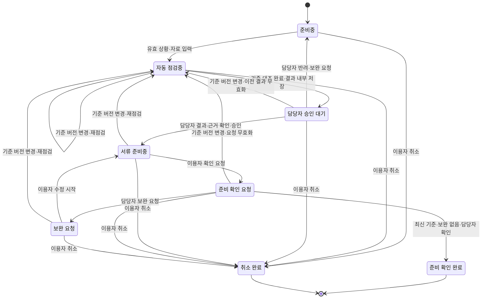

# 다문화가족 체류 행정 준비 도우미 — 프로젝트 제안서 초안

> Claude Code가 `docs/` 조사 파일만 읽고 만든 초안입니다(2026-10-13). 웹 검색은 하지 않았습니다. 문장 끝 `(출처: 02 2-2)`는 바탕 파일과 표 번호, `[B번호]`는 부록 B 참고 자료입니다. 조사 파일에 없는 내용은 `[조사 파일에 없음]`으로 남겼습니다. 팀 확인(README 2단계) 전 초안입니다.

| 항목 | 내용 |
| --- | --- |
| 프로젝트명 | `[가정]` 다문화가족 체류 행정 준비 도우미 (출처: topic-selection 4-4) |
| 한 줄 부제 | 다문화 가정이 잘 모르는 한국 법률·제도를 알려 주는 AI 챗봇 — 첫 기능: 결혼이민자의 체류기간 연장 준비 지원 (출처: README 팀 표, 2026-10-13 팀 결정) |
| 제안 팀 | multicultural-families (저장소 식별명) (출처: README 팀 표) |
| 도메인 | 다문화 가정의 한국 생활·법률·제도 정보 이용 (출처: README 팀 표) |
| 제출일 | 2026-10-13 (팀 결정) |
| 팀원 | 김민건, 권길현, 김태후, 여철준, 이주환 (출처: team/roles.md) |
| 팀 저장소 | https://github.com/rulrularla123/multicultural-families |

## 제안 요약

| 항목 | 내용 |
| --- | --- |
| 서비스 한 줄 정의 | 다문화 가정이 잘 모르는 한국 법률·제도를 쉬운 말과 모국어로 알려 주는 AI 챗봇. 첫 기능으로, 한국어 안내 이해에 도움이 필요한 결혼이민자가 체류기간 연장 준비 항목을 이해하고 담당자의 확인을 받아 부족한 항목을 보완할 수 있게 한다. (출처: README, 4-4, 2026-10-13 팀 결정) |
| 해결할 문제 | `[추정]` 결혼이민자는 체류기간 연장을 준비할 때 자신의 유형에 맞는 공식 안내와 서류 항목을 이해하기 어려워, 무엇을 준비했고 무엇이 부족한지 파악하기 어렵다. 언어 어려움 20.3%(2024)는 `[사실]` 배경이며[B3], 실제 서류 누락·재방문은 아직 확인하지 않았다 `[가정]`. (출처: 4-1 B, 4-4) |
| 핵심 기능 3가지 | F-03 쉬운 다국어 초안 / F-04 안내 검토·승인·반려 / F-06 보완·완료 확인 (출처: 5-2) |
| 기대 효과 | `[가정]` 같은 가상 사례에서 필수 항목 누락 수 감소, 준비 순서 이해 정답률 상승, 목록 작성 시간 단축. 수치 목표는 기준선 측정 후 정한다. (출처: 4-4, 5-1) |
| 고객께 요청드리는 것 | 미팅 전 고객사 설정(기관 유형·검토 가능한 담당자와 언어·기준 목록 갱신 책임) 정해 주시기, 질문 3가지 답변 (출처: Ⅶ-18) |

## Ⅰ. 제안 개요

### 1. 제안 배경

**도메인 현황**

결혼이민자·귀화자의 한국생활 어려움 중 언어 문제는 2024년 20.3%, 공공기관·은행 이용은 3.7%로 조사되었다(복수응답) `[사실]`[B3]. 체류기간을 넘어 계속 체류하려는 외국인은 만료 전에 연장허가를 받아야 하며 `[사실]`[B4], 정부24는 체류 유형(F-6 가·나·다목 등)에 따라 제출 서류를 구분해 안내한다 `[사실]`[B1]. 다누리콜센터는 생활정보·법률자문·통번역을 365일 24시간 지원한다 `[사실]`[B2]. 이 통계는 언어·기관 이용의 어려움이 있다는 배경이며, F-6-1 이용자의 연장 준비 문제나 손해를 직접 증명하지 않는다. (출처: 3-5, topic-selection 작성 상태 표, 5-jhlarry1109-01)

**근거**

| 번호 | 근거 (자료에 적힌 내용) | 태그 | 출처 |
| --- | --- | --- | --- |
| 1 | 결혼이민자·귀화자의 지난 1년간 한국생활 어려움(복수응답): 언어 문제 2021년 22.9% → 2024년 20.3%, 공공기관·은행 이용 2021년 6.1% → 2024년 3.7% | `[사실]` | [B3] |
| 2 | 체류기간을 초과해 계속 체류하려는 외국인은 체류기간이 끝나기 전에 연장허가를 받아야 한다 (출입국관리법 제25조제1항) | `[사실]` | [B4] |
| 3 | 부산·경남 여성 결혼이민자 136사례(2008) 중 기관에 정보·서비스를 요청하지 않은 이유로 "기관 존재를 몰랐다"가 사례 기준 74.6%. 오래된 지역 연구로 현재 전체 비율로 일반화하지 않음 | `[사실]` | [B5] |

(출처: 2-5, 3-5, cards)

### 2. 제안 목적

| 번호 | 목적 |
| --- | --- |
| 1 | 결혼이민자가 자신의 체류 유형에 맞는 공식 안내를 쉬운 말과 자신의 언어로 이해한다. `[가정]` (출처: 4-4) |
| 2 | 이용자가 무엇을 준비했고 무엇이 부족한지 확인하고, 담당자의 보완 요청을 받아 준비 항목을 채운다. `[가정]` (출처: 4-1 B, 5-1) |
| 3 | 담당자가 LLM 초안을 원문과 대조해 승인한 안내만 이용자에게 제공해, 오역·오래된 안내로 잘못 준비하는 일을 막는다. `[가정]` (출처: 3-4 L4, 5-4) |

### 3. 제안 범위

| 항목 | 내용 |
| --- | --- |
| 대상 사용자 | `[가정]` 주 사용자: 한국어 안내 이해에 도움이 필요한 결혼이민자. 첫 범위는 혼인 유지 중인 F-6-1 체류기간 연장 준비. 보조 사용자: 안내·준비 내용을 검토하는 가족센터 등의 지원 담당자(실제 참여 가능 여부 미확인). (출처: 4-4, 5-1) |
| 이번에 하는 것 | F-6-1 한 유형, 한국어와 담당자가 검토할 수 있는 외국어 1개. 준비 건 생성 → LLM 설명 초안 → 담당자 승인 → 준비 체크·확인 요청 → 보완 요청 → 재요청 → 준비 확인 완료 흐름을 가상 사례로 시연. (출처: 5-1) |
| 이번에 하지 않는 것과 이유 | 체류기간 연장 외 다른 법률 분야 안내(첫 기능 검증 후 확장), 민원 제출·예약·허가 조회, 모든 체류 유형, 개별 사건의 법적 판단, OCR·서류 진위 판정, 실제 서류 보관, 개인정보의 외부기관 자동 전송 — 범위·검증 부담 때문. 준비 확인 완료는 실제 민원 접수·허가 완료가 아니다. (출처: 5-1, 4-4) |

## Ⅱ. 현황 분석

### 4. 현재 방식과 문제점

**관련된 사람**

| 사용자 | 하는 일 | 지금 가장 큰 불편 |
| --- | --- | --- |
| 결혼이민자 | 체류 연장 등 생활 관련 법률·제도를 찾아 읽고 서류를 준비 | `[추정]` 한국어 법령·행정 용어가 어렵고 내 상황에 맞는 안내를 고르기 어려움. 언어 어려움 20.3%는 `[사실]`[B3], '법령 용어' 부분은 팀 추측 (출처: 02 2-1) |
| 지원 담당자 (가족센터 등) | 안내와 준비 내용을 검토하고 보완을 요청 | `[가정]` 상담 전 이용자 상황 파악에 시간이 걸리고 같은 질문이 반복됨. 미확인 (출처: 02 2-1, 4-4) |
| 상담원·통번역사 (다누리콜센터 등) | 전화·방문 상담, 3자 통화 통역, 기관 연계 | `[가정]` 법률 용어를 정확히 옮기기 어렵고 상황 설명이 반복됨. 지원 존재는 `[사실]`[B2], 불편은 미확인 (출처: 02 2-1) |

**지금 일하는 순서 (As-Is)**

| 단계 | 누가 무엇을 하나 (쓰는 도구) | 막히는 곳 |
| --- | --- | --- |
| 1 | 결혼이민자·배우자가 포털에서 검색 (포털, 블로그, 지식 Q&A) | `[가정]` 광고성 글이 섞이고 내 체류자격에 맞는 내용인지 판단하기 어려움 (출처: 02 2-2 2번) |
| 2 | 결혼이민자·배우자가 공식 사이트에서 제도를 찾아 읽음 (국가법령정보센터, 하이코리아, 정부24) | `[추정]` 법령·행정 문장과 용어가 어려워 이해에 실패함 (출처: 02 2-2 3번) |
| 3 | 결혼이민자가 상담원·통번역사와 전화·방문 상담 (다누리콜센터, 다문화가족지원센터) | `[가정]` 상황 설명을 처음부터 반복, 통역 일정이 맞아야 진행. 다누리콜센터는 24시간이므로 운영 시간 제약은 지역센터·방문상담에 해당할 수 있음 (출처: 02 2-2 5번) |
| 4 | 결혼이민자·배우자가 서류를 준비해 출입국·외국인관서에 신청 (신청서) | `[추정]` 서류 누락 시 재방문, 신청 기한을 놓칠 위험. 만료 전 연장허가 원칙은 `[사실]`[B4], 재방문 발생은 팀 추측 (출처: 02 2-2 6번) |

**이 문제로 생기는 손해**

`[가정]` 안내 이해 부족으로 서류 누락·반복 문의·재방문이 생길 수 있다. 누락·재방문 빈도와 시간·비용 손실은 아직 측정하지 않았으며, 언어 어려움 20.3%(2024)[B3]를 F-6 이용자의 연장 문제 비율로 해석하지 않는다. 손해의 크기는 Ⅶ-18 질문 1로 확인한다. (출처: topic-selection 작성 상태 표, 4-4)

### 5. 기존 서비스 분석

| 기존 서비스 | 잘하는 것 | 해결하지 못한 것 |
| --- | --- | --- |
| 정부24 체류기간연장허가 안내 | 체류 유형별 서류·기관 접점을 구분해 공식 기준·근거법령을 안내 `[사실]`[B1] | `[가정]` 이용자가 안내를 이해했는지, 무엇이 부족한지 확인·보완하는 과정은 다루지 않음. 공식 안내에 이용후기 없음 (출처: 02 2-4) |
| 다누리콜센터 | 생활정보·법률자문·3자 통화 통역·긴급지원을 365일 24시간 제공 `[사실]`[B2] | `[가정]` 준비 목록·보완 이력이 남지 않아 상황 설명을 반복할 수 있음. 대기·반복 설명은 미확인, 외부기관 자동 연동은 확인되지 않음 (출처: 02 2-4) |

| 시사점 | 내용 |
| --- | --- |
| 가져갈 점 | 유형별 공식 기준과 출처를 표시하는 방식, 기존 사람 상담·통번역 지원을 그대로 활용 (출처: 02 2-4) |
| 다르게 할 점 | 우리 서비스의 '준비 확인'과 기관의 허가를 구분하고, 준비 목록·보완 이력의 추가 가치를 별도 검증. 통번역 제공 자체를 차별점으로 주장하지 않음 (출처: 02 2-4, 4-5) |

## Ⅲ. 세부 주제 선정 과정

### 6. 검토한 문제 후보

| 후보 | 누구의 어떤 문제인가 (한 문장) | 근거 |
| --- | --- | --- |
| A. 다국어 법률·제도 안내 | `[추정]` 결혼이민자가 체류·혼인·자녀 등의 질문을 자신의 언어로 이해할 공식 설명과 연결하기 어려워 다음 행동을 정하지 못한다. | 02 2-2 2·3번, 03 3-1 R1·R2, 3-4 L1·L2. 배경 [B3], 기존 도움 [B2] |
| B. 체류기간 연장 준비 지원 | `[추정]` 결혼이민자가 자신의 유형에 맞는 공식 안내와 준비 항목을 이해하기 어려워 무엇을 준비했고 무엇이 부족한지 파악하기 어렵다. | 02 2-2 3·6번, 03 3-1 R2·R3, 3-4 L4. 배경 [B3], 유형별 서류 [B1], 접근 장벽 [B5] |
| C. 전문상담 연결 준비 지원 | `[가정]` 결혼이민자가 어느 기관에 무엇을 설명할지 정리하기 어려워 상담 준비에 시간이 들고, 상담원은 상황을 다시 파악해야 한다. | 02 2-2 5번, 03 3-2 전문기관 연계, 3-4 L3. 배경 [B3](상담 이용 경험 5.5%), 기존 기관 [B2] |

(출처: topic-selection 4-1)

### 7. 선정 기준과 평가

| 후보 | 상태 전이 있음 | LLM 자리 있음 | 점수 합계 | 결정적이었던 기준 |
| --- | --- | --- | --- | --- |
| A | ○ | ○ | 13 | ⑤ 8주 MVP 가능성 1점 — 다분야 질문과 법률 검토를 동시에 다뤄 범위가 큼 |
| B | ○ | ○ | 17 | ① 규칙 명확성·③ 상태·권한·⑤ MVP 가능성 3점 — 한 절차의 승인·보완·취소·버전 변경을 테스트로 쓸 수 있음 |
| C | ○ | ○ | 15 | ④ 외부 접점 2점·⑤ MVP 2점 — 기관 연동과 설명 부담 감소 효과 미확인 |

점수는 ①~⑥ 합계이며 `[추정]`인 비교 점수다. ⑦ 팀의 흥미는 실제 응답이 없어 제외했다. (출처: topic-selection 4-2, 4-3)

### 8. 최종 선정 이유

| 항목 | 내용 |
| --- | --- |
| 선정한 후보 | B. 체류기간 연장 준비 지원 |
| 고른 이유 | ①~⑥ 소계가 17점으로 가장 높고, 한 절차의 준비·보완·완료를 테스트로 설명하기 쉽다. ⑦을 나중에 반영해도 B는 최저 18점, C는 최고 18점이며 동점이면 ①·⑤에서 B가 우선한다. (출처: 4-3, 4-5) |
| 고르지 않은 후보와 이유 | `[추정]` A는 다분야 법률 설명과 정확성 검토 범위가 커 첫 흐름 검증이 어렵다. C는 기존 다누리 지원보다 상담 준비 시간을 줄일지, 담당자의 요약 검토가 가능한지 미확인이다. (출처: 4-4) |
| 같은 도메인 팀과 겹침 조정 | 같은 도메인의 다른 팀과 겹치지 않음을 확인했다. (2026-10-13 팀 확인) |

## Ⅳ. 제안 내용

### 9. 서비스 개요

| 항목 | 내용 |
| --- | --- |
| 서비스 이름 | `[가정]` 다문화가족 체류 행정 준비 도우미 (출처: 4-4) |
| 한 줄 정의 | 결혼이민자가 상황을 설명하고 준비 서류를 올리면, AI가 법률·공식 안내와 공통·관서별 기준을 찾아 대조해 주의점과 추가 준비 서류를 안내하고 담당자가 검토·승인하는 체류기간 연장 준비 지원 서비스. 주제 전환은 클라이언트 미팅 피드백이며, 이용자 전체의 문제나 효과가 확인됐다는 뜻은 아니다. (출처: client-meeting-1 피드백 1·6·9·10·11·13·14) |
| 핵심 가치 | ① 올린 서류를 해당 기준과 대조해 누락·기재 불일치·추가 확인 항목을 제시 ② 공통 기준과 관서별 추가 요구를 함께 고려해 다음 준비를 안내 ③ 담당자가 모든 준비 건의 분석 결과를 검토·승인한 뒤 이용자에게 제공 (출처: client-meeting-1 피드백 1·4·11·13·14) |
| 차별점 | ① 단순 번역에 그치지 않고 서류와 근거 기준을 연결해 검토 ② 관서별 추가 기준과 출처·기준일을 표시하는 방향을 검토하되 자료 관리 방식은 미확정 ③ 한국어와 외국인 배우자 모국어를 함께 표시 ④ 자동 점검과 담당자 승인을 구분 (출처: client-meeting-1 피드백 1·6·9·12·13·14) |

### 10. 목표 흐름 (To-Be)

| 순서 | 사용자가 하는 일 | 서비스가 해 주는 일 | As-Is와 달라진 점 |
| --- | --- | --- | --- |
| 1 | 이용자가 상황을 설명하고 지원 유형(F-6-1)을 선택해 준비 건을 만든다. 관련 PDF 서류를 추가한다 (**준비중**) | 입력에 식별정보가 포함됐는지 확인하고 등록된 공통·관서별 기준 자료를 연결한다. PDF 처리와 실제 서류 수용 범위는 개인정보·운영 조건을 확인한다. 스캔 PDF의 OCR 지원 여부는 미정이다. | 체크박스만 선택하는 대신 상황과 PDF 서류를 바탕으로 준비를 시작한다. 상황 설명 기반 안내는 클라이언트 제안이다. (출처: client-meeting-1 피드백 11; PDF 형식은 MVP 입력 범위 제안) |
| 2 | 이용자는 분석 결과를 기다린다. | 시스템이 등록 기준에 근거해 문서의 누락·기재 불일치·주의점·추가 확인 항목을 자동 점검한다. 결과가 나오면 담당자 승인 대기 상태로 보낸다 (**담당자 승인 대기**). 점검 결과는 승인 전 담당자용 참고 자료이며 승인으로 간주하지 않는다. | 담당자 부재 중에도 자동 점검을 진행할 수 있지만, 자동 점검은 담당자 승인을 대체하지 않는다. 자동 점검 필요는 클라이언트 피드백이며 세부 범위는 미확정이다. (출처: client-meeting-1 피드백 1·3·4) |
| 3 | 담당자가 문서와 근거 출처·기준일, AI가 표시한 항목을 확인해 승인하거나 보완·반려한다. | 승인된 분석 결과만 이용자에게 공개한다. 결과와 근거를 한국어와 외국인 배우자 모국어로 함께 표시한다 (**서류 준비중**). | 검토되지 않은 분석이 확정 안내처럼 이용자에게 제공되지 않으며 배우자 공동 확인을 지원한다. (출처: client-meeting-1 피드백 1·12) |
| 4 | 이용자는 안내된 주의점과 추가 서류를 확인하고, 준비 상태를 갱신해 확인을 요청한다 (**준비 확인 요청**) | 담당자는 미해결 항목과 이유를 남긴다 (**보완 요청**). 보완 후 재요청하면 최신 기준인지 다시 확인한다. | 이용자 상황과 서류에 연결된 다음 준비 내용을 확인할 수 있다. 관서별 기준은 최신 자료가 확인된 경우에만 적용한다. (출처: client-meeting-1 피드백 13·14) |
| 5 | 이용자가 보완 내용을 반영해 다시 요청한다 (**서류 준비중 → 준비 확인 요청**) | 담당자가 최신 기준 버전과 미해결 항목을 확인해 준비 확인을 완료한다 (**준비 확인 완료**). 이 상태는 민원 접수나 허가 완료를 뜻하지 않는다. | 준비 상태와 보완 이력을 남기는 기존 흐름을 유지한다. 업무 시간 절감은 아직 측정되지 않은 기대 효과다. (출처: 5-1; client-meeting-1 피드백 5) |

(출처: 5-1, 4-2 B 전이 조건)

분석 결과는 담당자 승인이 나기 전까지 내부 검토용이다. 준비 건마다 담당자가 승인해야 하며, 담당자가 부재해 자동 점검이 먼저 끝나도 승인 대기 상태를 유지한다. (출처: client-meeting-1 피드백 1·3·4)

### 11. 주요 기능 목록

| ID | 기능명 | 설명 | 사용자 | 우선순위 | 관련 상태 / LLM |
| --- | --- | --- | --- | --- | --- |
| F-01 | 상황 설명·준비 건 생성·PDF 추가 | 이용자가 본인 준비 건에 상황 설명, 지원 유형, 관할 기관(확인 가능한 경우), PDF 서류를 연결한다. 스캔 PDF의 OCR 지원과 실제 서류 업로드·보관 범위는 개인정보·운영 조건 확인 전까지 확정하지 않는다. | 이용자 | 필수 | 시작 → 준비중 |
| F-02 | 공통·관서별 기준 등록 | 담당자가 공통 공식 안내와 관서별 추가 요구를 구분해 등록하고, 출처·확인일·적용 절차를 관리한다. 관서별 정보의 수집·갱신 책임은 추가 확인이 필요하다. | 담당자 | 필수 | 기준 변경 시 관련 건의 이전 점검 결과를 무효화하고 재점검 대기 |
| F-03 | 서류·상황 기준 자동 대조 | 등록된 기준 자료를 검색해 서류의 주의점, 누락 가능성, 기재 불일치, 추가 확인 사항과 함께 준비할 서류 후보를 제시한다. 근거가 없거나 모호한 내용은 단정하지 않고 확인 필요로 표시한다. | 시스템·담당자 | 필수 | 준비중 → 자동 점검중 → 담당자 승인 대기 / LLM ○ |
| F-04 | 담당자 검토·승인·보완·반려 | 모든 준비 건에서 담당자가 원문·기준 출처·기준일과 AI 분석 결과를 확인하고 승인, 보완 요청 또는 반려한다. 담당자 승인이 있어야 분석 결과를 이용자에게 공개한다. | 담당자 | 필수 | 담당자 승인 대기 → 서류 준비중 또는 준비중 |
| F-05 | 검토 결과·두 언어 병렬 표시 | 승인된 분석 내용, 주의점, 근거와 추가 준비물을 한국어와 외국인 배우자 모국어로 함께 표시한다. 언어별 의미 확인 방식은 추가 확인한다. | 이용자·배우자 | 필수 | 담당자 승인 후 공개 / LLM 번역 보조 가능 |
| F-06 | 준비 상태·확인 요청 | 이용자가 승인된 안내를 보고 준비 상태를 갱신해 담당자에게 확인을 요청한다. 첫 시연에서 실제 서류를 받을지는 개인정보 조건 확인 후 정한다. | 이용자 | 필수 | 서류 준비중 → 준비 확인 요청 |
| F-07 | 보완·완료 확인 | 담당자가 부족 항목·이유를 지정하고, 최신 기준 일치·미해결 보완 없음일 때만 준비 확인을 완료한다. 민원 접수·허가를 뜻하지 않는다. | 이용자·담당자 | 필수 | 준비 확인 요청 → 보완 요청 → 서류 준비중 / 준비 확인 완료 |
| F-08 | 기준·검토 이력·취소 | 기준 버전, 자동 점검 결과, 담당자 승인·보완·반려 이력을 기록한다. 이용자는 진행 중인 본인 건을 취소할 수 있다. 실제 문서 보관 기간은 미정이다. | 이용자·담당자 | 필수 | 진행 중 상태 → 취소 완료 |
| F-09 | 담당자 부재 중 자동 점검 | 담당자 부재 중에도 등록 기준에 따른 자동 점검을 수행하고 결과를 승인 대기 건에 저장한다. 담당자 승인·공개 권한은 자동으로 부여하지 않는다. 점검 실패·근거 불일치는 담당자 확인 대상으로 남긴다. | 시스템·담당자 | 필수 후보 | 자동 점검중 → 담당자 승인 대기 / 최종 승인 아님 |
| F-10 | 대기·보완 알림 | 화면 내 대기·보완 표시. 동의한 채널 외부 알림은 후순위 | 이용자·담당자 | 선택 | 상태를 바꾸지 않음 |

(출처: 5-2; client-meeting-1 피드백 1·3·4·11·12·13·14)

### 12. 핵심 대상과 상태 흐름 (필수)

핵심 대상: **절차 준비 건**

정상 경로: 준비중 → 자동 점검중 → 담당자 승인 대기 → 서류 준비중 → 준비 확인 요청 → 준비 확인 완료

취소·반려·되돌림 경로:

| 어느 상태에서 | 예외 상태 | 다음 상태 |
| --- | --- | --- |
| 자동 점검중 | 자료 누락·점검 실패 | 담당자 승인 대기 (실패·불확실 사유 표시, 자동 승인 아님) |
| 담당자 승인 대기 | 담당자 반려 | 준비중 |
| 준비 확인 요청 | 보완 요청 | 서류 준비중 |
| 자동 점검중 / 담당자 승인 대기 / 서류 준비중 / 준비 확인 요청 / 보완 요청 | 기준 버전 변경 (기존 점검·확인 요청 무효화) | 자동 점검중 |
| 진행 중 상태 | 이용자 취소 | 취소 완료 (끝) |

| 전이 (지금 → 다음) | 누가 바꾸나 | 조건 | 되돌릴 수 있나 | 태그 |
| --- | --- | --- | --- | --- |
| 시작 → 준비중 | 이용자 | 지원 유형·상황을 입력해 준비 건을 만들고, 허용된 범위의 문서를 추가한다 | - | `[가정]` |
| 준비중 → 자동 점검중 | 시스템 | 상황 입력과 PDF 파일 형식을 확인한다. PDF에서 검토할 텍스트를 처리할 수 있는지 확인하며, 처리 불가 자료·식별정보가 있으면 점검을 시작하지 않고 수정·담당자 문의를 안내한다. 스캔 PDF OCR 지원은 미정이다 | 예 (자료 보완 후 재시작) | `[가정]` |
| 자동 점검중 → 담당자 승인 대기 | 시스템 | 공통·관서별 기준 검색과 서류 대조를 마쳐 결과·근거·불확실성을 기록한다. 결과는 담당자에게만 보이며 승인으로 간주하지 않는다. 담당자가 부재여도 승인 대기 유지 | 예 (자료·기준 변경 시 재점검) | `[가정]` |
| 자동 점검중 → 담당자 승인 대기 | 시스템 | 자동 점검 실패·불확실·근거 부족을 결과에 명시해 담당자 확인 대기로 보낸다. 실패나 불확실성은 승인으로 간주하지 않는다 | 예 (자료 보완·기준 갱신 후 재점검) | `[가정]` |
| 담당자 승인 대기 → 서류 준비중 | 지원 담당자 | 문서·원문·기준 출처·기준일·자동 점검 결과를 확인해 해당 준비 건을 승인한다 | 예 (기준 변경 시 재점검) | `[가정]` |
| 담당자 승인 대기 → 준비중 | 지원 담당자 | 분석 오류·자료 부족·추가 정보 필요를 이유와 함께 반려 또는 보완 요청한다 | 예 | `[가정]` |
| 담당자 승인 대기 / 서류 준비중 / 준비 확인 요청 / 보완 요청 → 자동 점검중 | 시스템 | 적용 기준 버전이 바뀌면 기존 분석·승인·확인 요청을 무효화하고 새 기준으로 다시 점검한다. 이용자에게 변경을 알린다 | 예 (재점검 결과에 따라 담당자 승인 대기) | `[가정]` |
| 서류 준비중 → 준비 확인 요청 | 이용자 | 승인된 목록의 준비 여부를 입력하고 확인 요청 | 예 (보완 요청) | `[가정]` |
| 준비 확인 요청 → 보완 요청 | 지원 담당자 | 누락·불명확한 항목과 이유를 지정 | 예 (이용자 수정 시 서류 준비중) | `[가정]` |
| 준비 확인 요청 → 준비 확인 완료 | 지원 담당자 | 안내 버전이 최신 기준과 같고 미해결 보완이 없음. 법적 효력·허가 가능성을 보증하지 않음 | 아니오 (새 건 생성) | `[가정]` |
| 준비중 / 자동 점검중 / 담당자 승인 대기 / 서류 준비중 / 준비 확인 요청 / 보완 요청 → 취소 완료 | 이용자 | 본인의 진행 건을 취소 | 아니오 (새 건 생성) | `[가정]` |

(출처: 4-2 B 전이 조건, 03 3-2; 담당자 승인·부재 중 점검 요구는 client-meeting-1 피드백 1·3·4)

### 13. LLM 활용 방안 (필수)

| 항목 | 내용 |
| --- | --- |
| LLM이 하는 일 | 등록된 법률·공식 안내와 공통·관서별 기준 중 해당 상황에 맞는 근거를 검색하고, 허용된 문서 내용과 대조해 주의점·누락 가능성·기재 불일치·추가 확인 항목·추가 준비 서류 후보를 설명한다. 관찰된 사실과 추정·불확실성을 구분하고 근거 없는 결론, 서류 진위 판정, 법률상 최종 판단을 하지 않는다. (출처: 3-4 L4; client-meeting-1 피드백 4·9·11·13·14) |
| 관련 기능 | F-03·F-05 (검토·승인은 F-04) |
| 무엇을 읽나 (입력) | 이용자가 입력한 상황 설명, 지원 유형·관할 정보(있는 경우), 업로드한 PDF에서 처리 허용된 문서 내용, 담당자가 등록한 공식 안내·공통 및 관서별 기준의 버전·출처·확인일. PDF 입력은 제안 범위이며, 실제 문서 수집·저장·전송 및 스캔 PDF OCR 지원은 별도 확인 전 미확정이다. (출처: client-meeting-1 피드백 11·13·14; 입력 범위는 `[가정]`) |
| 무엇을 내놓나 (출력) | 담당자 검토용 분석 초안: 적용한 기준과 출처, 문서에서 확인된 내용, 주의점·누락 가능성·기재 불일치, 추가 확인 질문, 함께 준비할 서류 후보, 불확실한 부분. 승인 후 이용자에게 한국어와 배우자 모국어로 표시한다. (출처: client-meeting-1 피드백 1·9·11·12) |
| 사람이 확인하는 곳 | 모든 준비 건마다 지원 담당자가 문서와 기준 출처·기준일, 대조 결과, 불확실성·추가 확인 사항을 검토하고 승인·수정·보완 요청·반려한다. 담당자가 부재 중 자동 점검이 끝나도 승인 전 결과는 담당자용으로 유지하고 이용자에게 확정 안내로 공개하지 않는다. (출처: client-meeting-1 피드백 1·3·4) |
| 상태 전이와의 관계 | 유효 입력 뒤 준비중 → 자동 점검중 → 담당자 승인 대기로 전이한다. 자동 점검 완료는 시스템이 기록하는 점검 결과이며 승인 상태가 아니다. 담당자 승인만 담당자 승인 대기 → 서류 준비중으로 전이시킨다. 점검 실패·근거 부족은 실패 사유를 남겨 담당자 확인 또는 이용자 자료 보완으로 보낸다. 기준 변경 시 이전 점검을 무효화하고 다시 점검한다. 완료 여부는 기존 규칙과 담당자 확인으로 결정한다. (출처: client-meeting-1 피드백 1·3·4; 4-2) |
| LLM에 보내지 않을 정보 | 실명·연락처·외국인등록번호·여권번호·주소 등 식별정보와 처리 승인 범위를 벗어난 원본 PDF·민감정보는 전송하지 않는다. PDF 텍스트 추출·스캔 PDF OCR, 저장·LLM 전송 가능 여부, 비식별화 방식과 보관·삭제 정책은 `[가정]`으로 남겨 운영 조건 확인 전 실제 서류를 처리하지 않는다. (출처: 3-4 L4, 5-2 공통 기준; 처리 범위는 미확정) |

## Ⅴ. 기대 효과와 성공 지표

| 구분 | 무엇이 | 지금 | 목표 | 어떻게 확인하나 |
| --- | --- | --- | --- | --- |
| 정량 | 필수 항목 누락 수 | `[가정]` 미측정 (기준선 측정 후 기입) | 기존 안내만 볼 때보다 감소 | 같은 난이도 가상 사례로 공식 안내만 본 경우와 비교 |
| 정량 | 준비 순서 이해 정답률 / 목록 작성 시간 | `[가정]` 미측정 | 정답률 상승, 작성 시간 단축 | 같은 가상 사례 비교. 담당자 검토 시간도 함께 기록 |
| 정성 | 이용자가 무엇을 준비했고 무엇이 부족한지 알 수 있다 | - | 보완 경로를 한 번 거쳐 준비 확인 완료까지 진행 | 첫 데모 시연에서 확인 |

재방문·비용 절감은 현장 데이터 확보 전에는 효과로 주장하지 않는다. (출처: 4-4, 5-1)

## Ⅵ. 추진 계획

### 14. 일정

(README 지시에 따라 초안에서는 쓰지 않음. 양식의 '우리 팀 목표' 칸은 주차별 목표로 채우고, 최종 목표는 8주차 '프로젝트 성공(최종 데모 완료)'으로 둠 — 2026-10-13 팀 결정)

### 15. 팀 구성과 역할

| 역할 | 이름 | 이 프로젝트에서 맡는 일 |
| --- | --- | --- |
| 팀 리더 (프로덕트 오너 겸) | 김민건 (rulrularla123) | 진행 관리, 요구사항을 백로그로 정리하고 우선순위 제안, 인수 조건 작성, 고객 질문과 결정 기록 |
| 테크 리드 | 권길현 (Hyun731) | 기술 방향·구조 결정, 리뷰 기준, 저장소·CI 관리, 병합 순서와 통합 |
| 개발자 1 | 김태후 (bbanana502) | 맡은 기능 구현, 테스트 작성. 기능 배정은 [조사 파일에 없음] |
| 개발자 2 | 여철준 (justhumannn) | 맡은 기능 구현, 테스트 작성. 기능 배정은 [조사 파일에 없음] |
| 테스트 담당 | 이주환 (jhlarry1109) | 인수 조건을 테스트 시나리오로, 개발 전 실패하는 테스트, PR 테스트 리뷰, 회귀 확인 |

역할은 스프린트마다 교대한다. 위는 S1 담당이다. (출처: team/roles.md)

## Ⅶ. 전제 조건, 위험, 고객 확인 요청

### 16. 전제 조건과 가정

| 구분 | 내용 | 태그 | 출처·근거 |
| --- | --- | --- | --- |
| 규칙 | 체류기간을 초과해 계속 체류하려는 외국인은 만료 전에 연장허가를 받아야 한다는 공식 원칙을 안내한다. 예외·제재는 포함하지 않는다 | `[사실]` | 03 3-1 R3, [B4] |
| 규칙 | 답변에는 항상 공식 출처와 기준일을 보여 주고, 근거가 없거나 담당자 승인이 없으면 제공하지 않는다 | `[가정]` 서비스 규칙 | 03 3-1 R2 |
| 규칙 | 준비 확인 완료는 최신 승인 목록에 미해결 보완이 없을 때 담당자만 처리하며, 민원 접수·허가 완료로 표시하지 않는다 | `[가정]` 서비스 규칙 | 03 3-1 R5 |
| 가정 | H1: 결혼이민자에게 체류 연장 준비 항목 파악·누락 문제가 실제로 있고 기존 도움만으로 해소되지 않는 부분이 있다 | `[가정]` | 5-3 H1 |
| 가정 | H2: 원문과 외국어 설명을 대조할 담당자가 참여할 수 있고 검토 시간이 감당 가능하다 / H3: 공식 기준 목록과 갱신 책임자를 정할 수 있다 | `[가정]` | 5-3 H2·H3 |

### 17. 위험 요소와 대응

| 위험 | 일어나면 생기는 일 | 대응 |
| --- | --- | --- |
| LLM 오역·항목 누락 또는 오래된 안내 | 이용자가 틀린 항목을 따르거나 준비 완료를 허가 완료로 오해 | 공식 원문·버전으로 생성 범위 제한, 모든 초안 담당자 승인, 변경 시 재검토, 완료 화면에 준비 확인의 범위 명시 |
| 개인정보·다른 이용자 기록 노출 | 식별정보가 LLM에 전송되거나 다른 계정이 기록을 봄 | 모의 계정·가상 사례만 사용, 실제 서류·등록번호 입력 제외, 허용 입력 검사·건별 접근 권한 확인, 외부기관 자동 전송 안 함 |
| 검토자 부족·범위 확대 | 승인 대기가 길어지거나 8주 안에 핵심 흐름을 못 끝냄 | 한 유형·한 외국어·모의 검토자로 시연, 외부 알림은 선택 기능, 검토 불가 시 언어·범위 조정 |

(출처: 5-4)

### 18. 고객 확인·협조 요청

**미팅에서 꼭 여쭙고 싶은 것 3가지**

| 번호 | 질문 | 이 답으로 정할 것 |
| --- | --- | --- |
| 1 | 최근 체류기간 연장을 준비한 사례 한 건에서, 이용자가 처음 한 일부터 준비를 마칠 때까지 어떤 일이 있었나요? 가장 시간이 들거나 다시 해야 했던 단계와 그 영향을 설명해 주세요. | 실제 문제 지점, 후보 B 유지 여부, 비교할 기준선 |
| 2 | 그 사례에서 안내를 읽고 준비물을 챙기고 내용을 확인한 사람은 각각 누구였나요? 실제 사용 언어와 도움받은 방식을 설명해 주세요. | 주 사용자·보조 사용자, 첫 언어, 담당자별 조회·수정·승인 권한 |
| 3 | 그 사례의 준비 항목이 맞는지 어떤 공식 자료와 기준으로 확인했나요? 같은 절차라도 항목이 달라졌던 사례와 그때의 판단 근거를 설명해 주세요. | 지원 유형·기준 목록·예외와 갱신 책임자 |

(출처: 5-5 우선순위 1~3)

**고객사 설정에서 정해 주셨으면 하는 것**

| 번호 | 정해 주셨으면 하는 것 | 정해지면 바뀌는 것 |
| --- | --- | --- |
| 1 | 고객사가 가족센터 등 지원 기관인지, 이용자 관점인지 | 질문 중심(검토·통번역 운영 / 최근 준비 경험)과 주 사용자 (출처: 5-7) |
| 2 | 원문·외국어 설명을 검토할 담당자와 그 언어 | 첫 데모의 지원 외국어, 검토 절차·부담 (출처: 5-1, 5-3 H2) |
| 3 | 공식 기준 목록을 확인·갱신할 책임자 | 첫 지원 유형 범위와 버전 변경 재검토 운영 (출처: 5-3 H3) |

## 부록

### A. 용어 정리

| 용어 | 뜻 | 헷갈리는 비슷한 말과 차이 |
| --- | --- | --- |
| 결혼이민자 | 한국 국민과 현재 혼인 중이거나 혼인한 적이 있는 재한외국인 `[사실]`[B7] | 결혼이민자등은 귀화허가자까지 포함해 범위가 더 넓음 |
| 결혼이민자등 | 다문화가족 구성원 중 결혼이민자 또는 귀화허가를 받은 사람 `[사실]`[B6] | 결혼이민자보다 포함 범위가 넓음 |
| 재한외국인 | 한국 국적 없이 국내 거주를 목적으로 합법적으로 체류하는 사람 `[사실]`[B7] | 귀화해 한국 국적을 취득한 사람과 구분 |
| 다문화가족 | 다문화가족지원법 제2조제1호가 정한 가족(결혼이민자·귀화자와 한국 국적 취득자로 이루어진 가족 등) `[사실]`[B6] | 일상적인 '다문화 가정' 표현과 법률상 범위를 구분 |
| 가족센터 | 가족 유형에 관계없이 교육·상담 등 가족지원 서비스를 종합적으로 제공하는 곳 `[사실]`[B8] | 다문화가족만 이용하는 기관으로 한정하지 않음 |

(출처: 01 1-2)

### B. 참고 자료

| 번호 | 자료 | 카드 |
| --- | --- | --- |
| [B1] | 정부24(제도 담당 법무부 체류관리과), 2026-06-29 변경·2026-10-13 확인, 체류기간연장허가, https://www.gov.kr/mw/AA020InfoCappView.do?CappBizCD=12700000097 | 1-jhlarry1109-01 |
| [B2] | 성평등가족부, 확인일 2026-10-13, 다누리콜센터(1577-1366) 운영, https://www.mogef.go.kr/sp/fam/sp_fam_f011.do | 4-jhlarry1109-01 |
| [B3] | 여성가족부(한국여성정책연구원·한국리서치 조사), 2025, 2024년 전국 다문화가족 실태조사 주요 결과, https://www.mogef.go.kr/nw/rpd/nw_rpd_s001d.do?bbtSn=710581&mid=news405 | 5-jhlarry1109-01 |
| [B4] | 국가법령정보센터, 시행 2026-10-02, 출입국관리법 제25조, https://www.law.go.kr/LSW/lsSideInfoP.do?docCls=jo&joBrNo=00&joNo=0025&lsiSeq=290729&urlMode=lsScJoRltInfoR | 2-Hyun731-03 |
| [B5] | 이용재·배화숙, 2008, 결혼이민자의 사회서비스 및 정보의 접근성에 관한 연구, 한국도서관·정보학회지 39(4), https://journal.kci.go.kr/liss/archive/articlePdf?artiId=ART001304858 | 1-rulrularla123-01 |
| [B6] | 국가법령정보센터, 시행 2025-12-30, 다문화가족지원법 제2조, https://www.law.go.kr/LSW/lsSideInfoP.do?docCls=jo&joBrNo=00&joNo=0002&lsiSeq=281953&urlMode=lsScJoRltInfoR | 2-Hyun731-01 |
| [B7] | 국가법령정보센터, 시행 2025-01-31, 재한외국인 처우 기본법 제2조, https://www.law.go.kr/LSW/lsSideInfoP.do?docCls=jo&joBrNo=00&joNo=0002&lsiSeq=268701&urlMode=lsScJoRltInfoR | 2-Hyun731-02 |
| [B8] | 인천광역시, 2024-08-28 업데이트, 가족센터, https://www.incheon.go.kr/welfare/WE0903051 | 4-Hyun731-01 |

[B6]~[B8]은 2026-10-13 팀원이 원문을 직접 열어 재확인했다.

---

## 검증 결과 (README 1단계)

- Ⅳ-12: 상태 8개(준비중·자동 점검중·담당자 승인 대기·서류 준비중·준비 확인 요청·보완 요청·준비 확인 완료·취소 완료), 반려·보완·기준 버전 변경·취소 경로 포함. 자동 점검 완료와 담당자 승인을 별도 전이로 표시 ☑
- Ⅳ-13: 담당자가 모든 준비 건의 분석 결과를 확인·승인하며, 자동 점검은 승인으로 취급하지 않음. 법률·진위의 최종 판단을 LLM에 맡기지 않고, 보내지 않을 정보와 미확정된 문서 처리 조건을 명시 ☑

## [조사 파일에 없음]으로 남긴 곳

제출일·팀 겹침은 2026-10-13 팀 결정으로 채움.

- Ⅵ-15 개발자 1·2의 기능 배정
- Ⅴ의 '지금' 값 (기준선 미측정 → `[가정]`, Ⅶ-18 질문 1로 확인)
